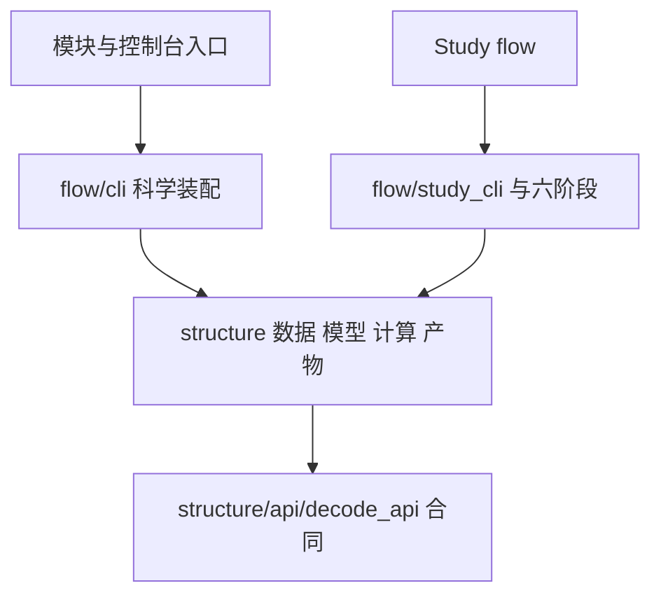

**去噪推测解码 代码结构设计**
更新日期：2026年11月5日。当前选定的源码方向。行为与质量合同见 [架构设计](<架构设计 Architecture Design 去噪推测解码.md>)，实施差距与验收见 [开发计划](<开发计划 Development Plan 去噪推测解码.md>)，历史目录演进见 [开发记录](<开发记录 Development Record/INDEX.md>)。

# 一、划分依据
研究者需要替换算法而保持输入、模型会话、验证观测及统计口径可比。因此科学合同、数据、模型、计算和产物分别拥有自己的状态，运行协调统一放在 flow。结构参考 RPipe，采用其 structure/flow 两柱，不复制参考仓库整套实现，不引入第二套运行器。

| **质量场景** | **必要职责** | **缺少时的后果与维护成本** |
| --- | --- | --- |
| Enmao 替换算法，历史观测仍能审计 | 计算与观测格式分开，依赖明确合同 | 改算法会牵动历史读端。维护版本化观测与对应反例 |
| 数据、模型替换不改变 τ 的定义 | 数据和模型各持有资源，纯统计集中 | Study 重复维护加载与统计。新增后端只需维护实际能力 |
| 只看结果时不加载权重 | CLI 延迟装配，包初始化不加载科学栈 | help 与只读比较占用设备。保持命令级依赖和导入测试 |
| 多个 Study 共享解码器 | 宿主不反向导入 Study，阶段链调用公共实现 | 私有实验细节污染宿主。维护少量明确入口及调用测试 |

# 二、目录与文件责任
`spec_mtp` 与 `studies/<name>` 顶层只留包标记及薄入口。新增机制位于 structure 或 flow，按责任聚合，不能以每个函数一个文件拆碎模块。没有真实消费者的目录、接口和注册器不创建。

| **位置** | **责任与状态** | **依赖边界** |
| --- | --- | --- |
| `src/spec_mtp/__init__.py`、`__main__.py`、`cli.py` | 包标识与命令转发 | 导入不执行研究或加载模型 |
| `structure/api/decode_api.py` | Prompt、DecodeRequest/Result、AuditResult、ModelSession、MaskPolicy、ObservationSink 合同 | 仅标准库和合同自身，不导入实现 |
| `structure/control/` | 配置、Run 身份、阶段生命周期所需状态 | 不依赖 flow |
| `structure/data/prompts.py` | SpecBench、本地输入、Dolly 的读取、渲染、编码与 EOS | 显式 tokenizer，不决定研究因素 |
| `structure/model/hf_causal.py` | 本地 HF 会话、能力、cache、forward、close 及配置构建 | 不导入解码循环，Torch 在 NumPy 前加载 |
| `structure/algorithm/decode/` | loop.py 的生成与验证，tree.py 的树构造和编辑，tree_attention.py 的注意力映射 | 只使用注入会话与策略，不导入具体 HF 接入 |
| `structure/algorithm/mask/` | providers.py 的策略与提交状态，fit.py 的拟合数学，factory.py 的方法装配 | 块内预测不污染长期 committed 状态 |
| `structure/algorithm/counts.py` | τ、接受数、配对和长度比较 | 纯计算，无文件读写、模型或阶段调度 |
| `structure/artifact/observation.py` | JSONL 写入、来源核验、提交链审计 | 验证保存表示，不补造观测、不决定 Run 终态 |
| `structure/artifact/` 其余模块 | 配置、结果、索引、来源和历史读端；provenance.file_sha256 统一流式哈希 | 保留真实持久化边界校验，兼容声明的 Python 3.10 |
| `structure/system/` | 设备、运行时、JSONL 诊断日志与资源 | 日志写入与原始科学证据分开，导入不配置环境或申请设备 |
| `structure/make/` | 声明展开与构建 | 不复制科学算法 |
| `flow/cli.py` | decode/audit/compare 参数、装配、结果呈现 | help 零 Torch/Transformers 导入，audit/compare 零载模 |
| `flow/study_cli.py` | 既有 Study 命令与阶段协调 | 由 `studies._shared.flow.cli` 接入，与科学 CLI 分工 |
| `flow/prepare/execute/collect/summarize/write/process/` | 默认六阶段，按声明协调 structure | structure 不反向导入 flow |
| `studies/<name>/structure/` | Study 专属声明适配、拟合与对照 | 可调用宿主，宿主不依赖 Study |
| `studies/<name>/flow/` | Study 阶段覆盖及命令编排 | 不复制整套宿主库 |

共享诊断按问题集中在 window_diagnostics、extension_diagnostics、sampling_diagnostics 等现有模块，当前消费者直接导入真实模块，不维护仅再导出的 diagnose_* 文件。历史 source_binding 中的原工具路径按冻结提交解释，不用新文件代替旧哈希。output_space_extension 的槽位审计计算复用 extension_diagnostics，离线命令位于其既有 flow/process/run.py，不另设顶层分析实现。

trajectory_observation 的 fresh_replace 选句、配对统计留在 structure/fresh_replace.py；其参数、显式本地模型与来源清单、CUDA 设备、本地 Dolly 输入和新外部输出编排位于 flow/execute/fresh_replace.py，直接复用 fair_branch 的校准与执行，不保留 structure 命令或再导出。

观测写入与只读审计共用同一格式和来源规则，放在一个 observation.py，避免为转调增加 flow 包装。纯比较与统计共用 counts.py，既有训练 MetricBundle 留在 metric.py，二者计算对象不同。公开合同与必要的 package 导出保留，数据、模型、审计和统计不保留旧路径再导出。`cli.py` 保留稳定控制台 API，只转交 flow 实现，现有平台入口无需修改。

科学 CLI 与 Study CLI 的实现分开，产品入口分别为 `python -m spec_mtp` 与 `python -m studies._shared.flow.cli`。flow 的包初始化只标记命名空间，调用方直接导入其使用的模块，避免通过包入口加载整个阶段链。

# 三、源码依赖与测试镜像
flow 可以导入 structure，structure 不导入 flow。宿主不导入 rpipe 或 studies。科学合同不导入其它 structure 子层。算法核心、输入、观测和统计不导入具体模型或 CLI。api 只维护科学合同，构建由所属层工厂提供，make_tracker 放在 algorithm/tracker.py。四个旧流程 API facade 已移除，直接反向导入例外为零。宿主structure/control及普通layer父包只标包身份，真实消费者直接导入职责模块；科学状态子包另按实际公开合同审查，不能把直接静态边为零推广为全仓轻量导入。

图表示源码依赖，运行调用与部署见架构设计。模型会话拥有物理 KV，解码器决定保留路径，树模块计算索引，三者以合同中的同一长度事实交互。

测试逐步镜像 `tests/spec_mtp/structure|flow` 与 `tests/studies/<name>/structure|flow`。每项测试在唯一 `tests/manifest.json` 声明 level、type、cost_class、result_type、priority 和 target，路径移动同步 test_id。纯包标记不机械新增测试，固定第三方原树不按本项目重新镜像测试。先复用已有行为与失败用例，不用路径快照替代行为验收。

# 四、约束与检查
`tests/spec_mtp/test_structure_flow_gates.py` 扫描文件落点、导入方向、structure 内命令、盘符和 import 时环境写入。`legacy_allowlists` 必须与现状逐项相同，并且相对 dev 只能缩小。迁移不得靠移动违规字符串到新文件增加清单。`.importlinter` 与 CPU 依赖测试核对相同的核心边界，未运行的工具不记通过。

派生输出根通过 artifact.paths.validate_output_root 显式校验，与输入及 checkout 双向分离。report 必须提供 --out，旧槽位分析必须提供 --output-root，目标文件独占创建，不默认写 Study/docs。历史文本读取由 provenance.read_historical_bytes 显式接收仓库、固定完整提交、相对成员及期望 SHA256，只查本地 Git blob，不执行归档代码或猜测换行变体。旧槽位读端还必须显式接收原运行矩阵及 Git 原件摘要，两者分别校验并比较 JSON 内容，字节哈希不混用。完整运行根采用外部 Study 工作目录：make/run/launch 接收 --run-root，将声明、两柱源码、recipe 与 provenance.include 白名单冻结到该根，以此根统一生成 runs/shared/docs/index/锁与诊断。artifact/layout.py 维护建立和校验，不新增全局路径映射；命令在写锁前转交外部根。study_source.json 记录原 Study 路径、逐文件摘要及 Git 身份，原 Study 与快照改动都阻断执行，重复相同绑定只校验不重签。绝对自 Study 导入仍来自当前 checkout，因此来源校验继续覆盖原 Study；快照不承诺独立脱离宿主运行。旧 Run 保持原路径只读。单个冻结静态成员限16MiB、总量32MiB，模型与大数据只引用既有来源清单。

新诊断保存于 assets/logs/events.jsonl。status/logs/report 共用新旧路径读取，旧 run.log 只读保留。Logger 的运行身份在同进程实例间共用，task_id 区分 Run，异常不保存原始载荷。日志轮转、保留和失败隔离的剩余工作见开发计划。

`tests/run.py --plan cpu-pr --output-root <外部新验证根>` 适配 pytest，必需项缺收集、失败、跳过、缺终态、证据写失败均阻断。整批预算 420 秒，不覆盖真实权重、CUDA、测速或采样分布保证。验证产物和临时材料进入本次明确的外部任务目录。

# 五、源码与制品
| **位置** | **保存内容** |
| --- | --- |
| `src/spec_mtp/` | 公共实现和固定第三方来源 |
| `studies/` | 静态声明与必要适配，不生成第二套计划和报告 |
| `datasets/spec_bench/` | 保留原始静态输入与来源 |
| `tests/manifest.json` | 静态元数据，实际执行证据另存 |
| `docs/` | 当前七类工程文档及独立文献调研、研究计划，历史按日期记录 |
| 显式外部运行根 | raw、日志、trace、输入与源码快照、验证和派生图 |

`structure/algorithm/reference/esp_reproduction_artifacts/upstream/` 全树与旁侧 ORIGIN.json 保持字节，保留版权与许可证。历史记录中的旧路径、Run 和哈希按原执行身份解释，不回签。原始数据、模型与不明文件不因代码清理删除。

独立worker与专用启动/重验证入口复用shared flow的check_study_inputs纯预检，先验外部根、原源/快照、来源锁、计划与输入，再允许运行态写入。scheduler固定当前宿主的导入根，worker走shared CLI，默认不自动重试；派发异常停止新派发并只清理本次已拥有的Popen对象，保存首错。保存jobs需与当前index及规范config路径一致；已完成Run调度恢复只跳过已完成项，不能外推checkpoint/RNG等价恢复。

trajectory的office三类命令集中于flow/execute/office.py，structure保留协议、纯统计与已有测量实现。新专用协议运行须显式本地模型目录/完整来源清单、Dolly JSONL、固定计划SHA和新外部输出，载模前完成来源与正式dirty检查，输入与代码读后复核；不续写历史root。它没有study.yaml，故不称通用Study快照，原协议旧prefix保留，运行绑定另记实际源码/输入/模型/设备。永久停止的BF16/独立AR机理入口拒绝新派发。

native训练恢复沿现有职责实现，不新建恢复框架：`algorithm/base.py` 分离只读 `load_resume` 与 `apply_resume`，`algorithm/resume.py` 负责持久化状态准入与RNG校验，`algorithm/train/` 先构造合同并准入、再应用；`system/factory.py` 的 `checkpoint_path` 与读取共用只读路径规则，保存仍由原System维护。`data/factory.py` 的 `validate_training_state` 纯校验v2数据状态，`data/resume.py` 维护游标及sampler/loader generator关系。测试在 `tests/spec_mtp/structure/{algorithm/train,data,system}/` 镜像，独立进程夹具只在测试内，不成为生产入口。当前分工对照远端RPipe main固定414ccb7的读取、准入、应用与原子快照机制，未复制其整套库或更改本仓旧编码。

`flow/execute/fair_branch.py` 拥有原fair协议CLI与会话生命周期，`fresh_replace.py` 内的 `prepare_local_inputs` 供两条replacement flow共用本地输入预检，返回已解析的输入路径和绑定复核，不让各入口重新跟随原路径别名。`structure/fair_branch.py` 保留纯参数化的选择、校准和统计，移除main、固定模型路径与联网读件。pytest按当前pyproject使用importlib模式，入口镜像测试以 `test_fair_branch_entry.py`、`test_fresh_replace_entry.py` 区分同名结构测试。

pilot与preforward_signal的CLI、输出发布及会话生命周期同样归各自 `flow/execute/`。pilot显式冻结本地config、计划SHA、源码和CUDA设备；structure保留合成数据、训练及各既有模式的数学。preforward复用本地模型/输入准入，固定81–208与128条校准模板，structure只接显式rows和设备，不猜模型目录。宿主mask拟合的辅助张量与输入device一致，不依赖默认CPU；不以搬目录改变公式。

small_matrix 的 transfer/cross-prompt/trajectory/window 分析由现有 `flow/process/run.py` 编排，纯状态、槽位比较与诊断复用已有 `studies/_shared/structure/extension_diagnostics.py`。两套绘图由现有 `flow/write/run.py` 编排，一个 `structure/plots.py` 容纳纯 Figure 构造，避免保留两份入口、路径与输入读取。固定 Git 原件、实际报告与张量独立绑定，不执行归档源码或按当前 manifest 替换历史身份，新工具来源另记。新外部输出完整后才发布完成记录，JSON 读件不伪称 CUDA 计算，保存张量的数值检查显式使用 CUDA。

trajectory 的 bonus-aligned/output-hidden 专用命令共用一个 `flow/execute/hybrid_gain.py`，沿既有本地模型、输入与计划准入机制组织生命周期及共同收集/落盘。两份 structure 保留各自既有协议、纯校准与统计公式，共同模板和统计复用已有纯函数，不另建助手文件。原切片、arm 与预算各自冻结，收尾核来源、完整 qid 集及关闭模型后才发布新运行的完整标记，旧根不续写。测试按上述两柱职责镜像。

共用 fingerprint/profile 命令集中到 `studies/_shared/flow/diagnostics.py`，不混入六阶段 Study CLI。两份 structure 保留显式输入的解码计算、比较、component 与报告格式，flow 拥有微型模型创建、CUDA 设备、来源/配置/计划绑定、输出和关闭。fingerprint 既有 cell 矩阵、统计和种子保持，比较须注明工作负载与设备身份，未知旧报告不自动成为可比基线。profile 的 cProfile 仅解释 CUDA 工作负载的主机侧调用耗时，不能冒称 CUDA kernel 测量或重解释旧 CPU 结果。旧 structure 不保留命令 wrapper。

`output_space_prerequisite` 的 q171 历史图归既有 `flow/write/run.py`，一个 `structure/plots.py` 保留三臂原数值、样式与 Figure 构造。编排复用固定 Git 取件和外部根边界，输入与绘图源码前后核对，PNG 摘要及实际渲染环境进入完成记录。该 Study 没有合适的现有纯绘图模块，此文件承担必要的两柱边界，不为其余 Study 预建空壳。

small_matrix 窗口重绘区分原运行件与后补归档附注。固定 Git window 仅可比原件新增顶层 `resources`、`cross_order_first_seed_masks`，scale 仅可新增 `resources`，共有字段仍须全部相等，原运行件不得多字段或缺科学字段。归档附注按固定 Git 成员单独记录，不混入原运行 JSON、source_binding 或绘图输入。observer 原字节仍必须匹配 scale 保存的 SHA，原件与旧 binding 不改写。其余报告保持完整内容等价合同。

五方法配对读端由 `qwen3_4b_bf16_five_methods/structure/readout.py` 承接既有 case、逐行配对、汇总和 published 复核，`structure/plots.py` 保留配对矩阵与 Figure。正式保存报告入口归既有 `flow/process/run.py`，固定 Git 与实际报告分别绑定，复核既有 480×11 计数和 WTL；绘图归既有 write。显式原 Run 根仅能复核报告已有文件摘要，不以当前源码验证器改签历史 gate。原生 cell 读取 API 的当前来源校验保持，历史 native 重验的额外来源合同未完成时明确不支持。paired_revalidation、bias_norm_scan 与共用 geometry 直接依赖真实 readout/plots，不再按旧顶层路径动态装载。

ESP 四格汇总、图与独立复验消费者的计算归各 Study 必要的 structure readout/plots，编排与输出归现有 process/write。相同统计复用共同实现，BC10 的 primary/auxiliary 身份、argmax/AR 边界、四格顺序与原阈值分别保持。固定保存证据读件与原生 Run 校验分开，不运行旧矩阵或改第三方原树。

input_mask_baseline 的历史 q171 图采用既有 write 编排与一个纯 plots 模块，保留 accepted 柱、保存的 cosine sums/counts 相除及零计数不画线的语义。固定来源为其原报告身份，不套用 output-space 摘要或窗口归档附注例外；输出仍为外部新根、来源复核后的 PNG 与完成记录。

4B recheck、recheck_v2、holdout 与 input_control 的配对统计归同一 `studies/_shared/structure/paired_4b.py`，原生输入和各 Study 的质量、来源与计数合同分别保留。共同读件协调归 recheck_v2 既有 process，复用保存读件会话，仅覆盖本组源码范围；另外三条 process 选择对应协议并保留六阶段导出。holdout 与 recheck_v2 的中文报告、Figure 共用 `studies/_shared/structure/paired_report.py`，既有 shared write 负责固定报告身份、真实输入链接与外部输出，并为两类图共用完成记录失败清理。三个相同统计模块及两份相同报告不各自继续演进；不能因合并统计而混同主批次、留出批次或 EMA 对照。不另建转调文件。

cross_task 的 first-delta、sampling-expansion 和 continuation 按同一采样路径问题归入 `structure/sampling_readout.py`，保留原 trace、净差分解、逐单位汇总与判读公式，命令由既有 process 调度。历史 acceptance 图由既有 write 与一个纯 plots 模块承接，保留原 q241–244 与单独 q241 计数口径。固定 Git 原件、实际输入及当前工具身份分开，读件前后复核，新完成标记最后发布；其余张量/模型协议不借此次入口收束重启。

cross_task 其余原生导出、H1/H3 判读与 canonical 审计按同一原生证据问题归 `structure/native_readout.py`，三条命令由一个 `flow/process/native.py` 协调。局部状态扩展、状态因素、采样 owner 与捕获深度的纯审计共用 `structure/state_readout.py`，显式读件与 CUDA 生命周期归一个 `flow/process/state.py`。既有 process/run.py 只协调三个问题组并保留原六阶段 callable，不为每条命令另建文件或恢复兼容 facade。新增两组各替代多个旧入口，其持续成本由独立输入合同和镜像失败用例承担；共享来源、路径和发布仍复用既有机制。

continuation 的完整验证必须区分原历史材料与工程夹具。实际历史审计须逐一核旧选择、输入清单、数据、上下文张量和原 tool/plan 字节，原件不齐不得用新源码或换行变体补签。工程 CUDA 夹具可覆盖六单位、三类固定 draw-bank 统计及损坏反例，但不称历史重验或新的采样实验。

状态数值审计的 FP32/FP64 概率和 margin 数学保持，实际计算设备单独记录。新 CUDA FP64 结果使用对应设备字段，旧 CPU FP64 字段仅随固定历史分析原件作为参考保留，未提供原件时记未知，不用当前 CUDA 值冒名旧 CPU 测量，也不承诺两设备逐位相同。

paired_revalidation 和 bias_norm_scan 的配对、复用端点及深度计数继续使用五方法 readout 和既有 geometry；参数解析、来源读取和新输出归各自已有 process。norm 专属纯深度/分组聚合确需独立职责时归其一个 `structure/readout.py`，不为 paired 再复制一份统计库。真实调用方直接导入纯模块，旧顶层分析入口删除。保存报告复核与原生 Run 重新验收分别给出范围，缺少原来源链时拒绝受影响路径，不拿当前源码重签。

native/state 的历史验证复用现有角色索引及每成员固定提交，不新建归档执行器。实际保存件、原 tool/plan、EOS 和上下文分别锁定，当前读端只执行本仓实现；数学和原科学判据保持，历史未知与新诊断差异进入独立回执，不用目录迁移改变结果。

四个 output_space_4b Study 共用既有部件：UntimedEval 归 `_shared/structure/algorithm.py`，CUDA 直接物化工厂归既有 model.py，显式适配注册归既有 recipe.py。Study recipe 在 register(ctx) 通过原准入后选择该适配，导入模块不再全局注册。四份相同 untimed_4b 删除，计时零占位、warmup 禁止和完整 token/argmax 语义保持，不新建四份转调文件。

资源观察、纯 capacity 判定和准入服务集中于一个 `_shared/structure/resource_admission.py`，调用方显式提供 capacity 与 observer，区分原 nonofficial/norm/paired 政策，不临时改写模块全局观察器。完整校准生命周期归 norm_scan 的单个 `flow/execute/capacity.py`，显式本地模型/完整清单、冻结输入/计划/配置、CUDA 与新外部根，关闭模型和最终来源复核后才发布完成记录。原 q295、1500 输入、256 输出及 template/scale2 协议保持，工程修复只让当前显式 mask_policy 真正接入原观察钩子，不重签旧 capacity。

配对与方向控制复用现有 shared 两柱：配对执行与方向生命周期归 `structure/algorithm.py`，方向向量的原公式归 `geometry_4b.py`，输入准入归 `validation.py`，注册归 `recipe.py`。普通与 recovery 的准入策略显式区分，等待记录使用实际资产根；不得用模块全局替换串改另一协议。随机方向保留原 CPU generator 的种子序列与随后到目标设备的转换，不能在目录整理时改成另一随机过程。三个旧顶层控制入口不保留 facade，norm/paired 的实际消费者直接依赖所属部件。

ESP preflight、numerics、reduction_check 与 shape_check 的相同 4B untimed 适配沿用已有共享 algorithm/model/recipe，特殊数值与 shape 合同仍由各自部件承担。导入不注册，只有原 Study 来源门通过后的显式 register 才装配；配置删除旧 include，旧 Run、锁和原字节来源身份保持。此归并不恢复已停止的 BF16/独立 AR 机理排查，不产生新的性能数字。

ESP 的后端状态作用域与模型局部 Linear 作用域集中到唯一 `_shared/structure/esp_controls.py`：三份相同 NumericsEval 和依赖它的 ShapeEval、rowwise_linear 共用原实现，显式注册选择最终执行类。此模块隔离特有后端控制，避免 evaluate 与 algorithm 循环依赖，也不把三份副本搬成三份小模块；代价是维护一个作用域及其成功/异常恢复合同。原数值公式、状态恢复顺序和输出字段保持，调用方直接导入该模块。

norm、paired repeat 与 continuation 控制继续复用上述 shared 职责：初始 bias 的纯观察归 geometry，三个执行类归 algorithm，来源表、固定 Git 计划和配对矩阵合同归 validation，recipe 在原门之后显式绑定运行根、已核原源、Run assets 和准入策略。Continuation 保留自身加 norm 的原来源链，采用 paired 的 observer 与 norm capacity，不额外混入 paired 来源门。三份顶层实现删除，容量入口和保存读件冻结实际新部件，原 refs/Run/计划身份另留，不能以路径变化绕过原锁。

ESP full/Qwen 的 numeric policy、full_argmax 的独立提交链观察及非官方复验继续归已有 esp_controls；四份 untimed、两份相同 argmax 与非官方 contract 不各自维护副本。NumericPolicyEval、ArgmaxEval 与 RevalidationEval 分别承接原作用域与附加门，recipe 显式选择，实际来源表/固定 Git 计划的共同校验归 validation。非官方模型摘要、480 条原输入、逐 prompt 准入和完整数量门独立保留，audit 独占创建、异常时移除 hook 并恢复原调用，不把原 AR exact 与 argmax 两类质量定义混合。

full 的完整 AR 读件及中文报告由一个必要的 `structure/readout.py` 承接，既有 `flow/process/run.py` 负责显式输入根、执行源码根、新外部输出和最终发布。计数复用 full_argmax 的纯统计，四格声明作为显式参数传入，默认 argmax 角色不变；full 的 BC10 auxiliary 与完整 AR 不一致仍按其原判据报告。来源和输入先核、读取后再核，完整观测与质量通过分别记录，不以相邻协议的质量门筛掉旧负结果，也不为一个旧命令新建转调文件。

smoke 的 cell/trace/比较合同及历史 CPU Figure 共用一个 `structure/validation.py`，当前 tiny CUDA 的模型、36 格流程和发布归 `flow/execute/run.py`，历史图的显式输入/输出归既有 `flow/write/run.py`。删除两个旧顶层入口，不保归档布局 fallback 或依源码行号的 sys.settrace。原 CPU 报告按原身份只读；新 CUDA 版本冻结输入、模型、矩阵、RNG、dtype/backend 与设备，比较先校可比身份，不能把跨设备结果当原 CPU bitwise 迁移证明。T0 完整 argmax 为门，采样 AR 一致仅诊断，保原三 variant、四 prompt、三温度与种子/预算。

extension 的 numerics、kernel、operator 保存张量审计集中到一个 `structure/saved_diagnostics.py`，命令及读件生命周期归既有 process。复用既有角色索引准入，只通过可选 session 类型切换实际读端来源范围，默认 cross-task 行为不变；原 tool/plan/common 与报告按各自旧字段精确绑定，不执行归档源码。共同 slot/margin 仅新增显式 device 参数，默认旧 CPU 语义不变，当前保存张量计算显式 CUDA，当前CUDA FP32 margin与旧CPU参考分身份记录。删除四个旧入口；已停止的真实模型加载/profiler 不提供当前派发 API，必要保存张量检查保留，未使用的live专属助手删除，原 common 路径只作固定 Git 历史成员。

父包只标识职责边界，普通部件消费者依赖实际leaf模块，不经structure/control及各layer父包间接装配工厂或加载Torch。control.layers不另保四种配置类型的facade，配置直接来自algorithm/data/model/system.config；make的展开并写入Study生命周期归已有make/write.py，包父入口不保实现。保留必要包文件与默认六阶段，不给移除的再导出加lazy wrapper。此取舍减少导入副作用和循环依赖，代价是同步本仓所有真实符号消费者并公开当前导入位置。

旧配置兼容只承接实际decoder输入，不保无生产调用的第二套文件读取或覆盖命令。spec_for每次返回独立的树配置，单次branches覆盖不得改变后续默认；YAML配置入口区分空文档与false/0/空序列等非法非mapping，持久化坏输入不得静默归为空配置。验证使用镜像纯配置/IO用例，数值路径仍由CUDA计划覆盖。

测量结果合同仍由既有tests/run.py及tests/test_run.py承担，不新增生产模块。numeric或明确请求metrics/samples的用例先声明唯一metric_specs（name/unit/statistic），经record_property提交同名测量，核有限实数、单位与口径、正样本数、非负暖机、数据规模/环境/测量边界及本轮支持的inline raw_samples；不建立附件执行器。重复property、空/缺采集、无call或阶段不完整不能覆盖成成功。有效numeric终态为测量完成，质量判定保持未评估，不混入categorical质量通过；categorical原断言合同保持。每个参数结果独立保存，失败测量保留已发生事实，整批仍严格阻断。

当前声明文档入口与冻结历史来源各有职责：只有实际消费者用作当前导航的引用可跟随唯一中文文档入口；历史source_path/member/commit/blob/hash随原协议保留，不能因路径改名重签或根据同名猜原件。新make必须冻结实际声明，旧Run与来源锁不写回。

批次报告仍由既有tests/run.py与tests/test_run.py维护，不新增生产模块或独立报告CLI。运行根保存本次有效声明/计划与environment快照、selection、phase/result；render_report(root)从实际落盘证据生成report.md。报告分开执行、测量、质量、成本与未验证范围，保source/level/type/priority/cost汇总、预算/设备/时间及证据定位；未知资源不填零，不从研究计数推性能。原始longrepr只留诊断证据，正文只显示错误类别，不扩散敏感载荷。

summary为最后完成依据：先保存pending、生成报告并绑定SHA，再发布正式summary；报告或证据写失败只能失败。缺收集或CUDA不可用也保明确未执行范围和失败报告；不把未枚举参数当已完成。报告核声明、环境、选择和终态的一致身份/计数，拒绝漂移或把numeric改为质量通过，不用派生报告重新签原事实。只读重建函数不覆盖旧文件，不新增附件/基准框架。

测试公共子进程拥有关系只用已有_process_tree，避免conftest重复装载同一helper。纯phase派发镜像归宿主flow/study，continuation保存声明/计数检查归已有norm读件镜像；默认六阶段及停止的研究协议不改。

shared CLI 的 native smoke 与其参数/调用性质共同归 `tests/studies/_shared/flow/test_cli.py`，按 NS0–NS4 独立定义 CUDA 验证身份。设备初始化适配只存在于测试复制的 recipe，生产模型工厂及原 Study 声明不因此改写；实际输入、模型摘要和后端随原采集链冻结。纯来源性质归已有 `structure/test_sources.py`、配置性质归已有 `structure/test_config.py`，来源门和声明因子性质归实际 `structure/test_validation.py`；测试直接调用真实所属部件，不保混合 properties 文件或 flow facade。每个原性质、Hypothesis 参数规模、失败判据及历史排除仍分别维护。
