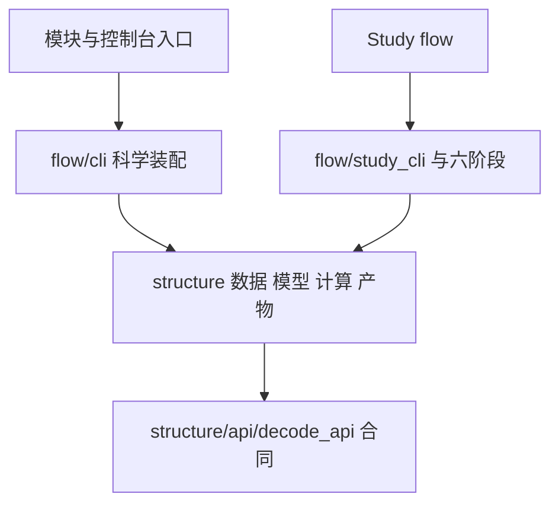

**去噪推测解码 代码结构设计**
更新日期：2026年11月5日。当前选定的源码方向。行为与质量合同见 [架构设计](<架构设计 Architecture Design 去噪推测解码.md>)，实施差距与验收见 [开发计划](<开发计划 Development Plan 去噪推测解码.md>)，历史目录演进见 [开发记录](<开发记录 Development Record/INDEX.md>)。

# 一、划分依据
研究者需要替换算法而保持输入、模型会话、验证观测及统计口径可比。因此科学合同、数据、模型、计算和产物分别拥有自己的状态，运行协调统一放在 flow。结构参考 RPipe，采用其 structure/flow 两柱，不复制参考仓库整套实现，不引入第二套运行器。

| **质量场景** | **必要职责** | **缺少时的后果与维护成本** |
| --- | --- | --- |
| Enmao 替换算法，历史观测仍能审计 | 计算与观测格式分开，依赖明确合同 | 改算法会牵动历史读端。维护版本化观测与对应反例 |
| 数据、模型替换不改变 τ 的定义 | 数据和模型各持有资源，纯统计集中 | Study 重复维护加载与统计。新增后端只需维护实际能力 |
| 只看结果时不加载权重 | CLI 延迟装配，包初始化不加载科学栈 | help 与只读比较占用设备。保持命令级依赖和导入测试 |
| 多个 Study 共享解码器 | 宿主不反向导入 Study，阶段链调用公共实现 | 私有实验细节污染宿主。维护少量明确入口及调用测试 |

# 二、目录与文件责任
`spec_mtp` 与 `studies/<name>` 顶层只留包标记及薄入口。新增机制位于 structure 或 flow，按责任聚合，不能以每个函数一个文件拆碎模块。没有真实消费者的目录、接口和注册器不创建。

| **位置** | **责任与状态** | **依赖边界** |
| --- | --- | --- |
| `src/spec_mtp/__init__.py`、`__main__.py`、`cli.py` | 包标识与命令转发 | 导入不执行研究或加载模型 |
| `structure/api/decode_api.py` | Prompt、DecodeRequest/Result、AuditResult、ModelSession、MaskPolicy、ObservationSink 合同 | 仅标准库和合同自身，不导入实现 |
| `structure/control/` | 配置、Run 身份、阶段生命周期所需状态 | 不依赖 flow |
| `structure/data/prompts.py` | SpecBench、本地输入、Dolly 的读取、渲染、编码与 EOS | 显式 tokenizer，不决定研究因素 |
| `structure/model/hf_causal.py` | 本地 HF 会话、能力、cache、forward、close 及配置构建 | 不导入解码循环，Torch 在 NumPy 前加载 |
| `structure/algorithm/decode/` | loop.py 的生成与验证，tree.py 的树构造和编辑，tree_attention.py 的注意力映射 | 只使用注入会话与策略，不导入具体 HF 接入 |
| `structure/algorithm/mask/` | providers.py 的策略与提交状态，fit.py 的拟合数学，factory.py 的方法装配 | 块内预测不污染长期 committed 状态 |
| `structure/algorithm/counts.py` | τ、接受数、配对和长度比较 | 纯计算，无文件读写、模型或阶段调度 |
| `structure/artifact/observation.py` | JSONL 写入、来源核验、提交链审计 | 验证保存表示，不补造观测、不决定 Run 终态 |
| `structure/artifact/` 其余模块 | 配置、结果、索引、来源和历史读端；provenance.file_sha256 统一流式哈希 | 保留真实持久化边界校验，兼容声明的 Python 3.10 |
| `structure/system/` | 设备、运行时、JSONL 诊断日志与资源 | 日志写入与原始科学证据分开，导入不配置环境或申请设备 |
| `structure/make/` | 声明展开与构建 | 不复制科学算法 |
| `flow/cli.py` | decode/audit/compare 参数、装配、结果呈现 | help 零 Torch/Transformers 导入，audit/compare 零载模 |
| `flow/study_cli.py` | 既有 Study 命令与阶段协调 | 由 `studies._shared.flow.cli` 接入，与科学 CLI 分工 |
| `flow/prepare/execute/collect/summarize/write/process/` | 默认六阶段，按声明协调 structure | structure 不反向导入 flow |
| `studies/<name>/structure/` | Study 专属声明适配、拟合与对照 | 可调用宿主，宿主不依赖 Study |
| `studies/<name>/flow/` | Study 阶段覆盖及命令编排 | 不复制整套宿主库 |

共享诊断按问题集中在 window_diagnostics、extension_diagnostics、sampling_diagnostics 等现有模块，当前消费者直接导入真实模块，不维护仅再导出的 diagnose_* 文件。历史 source_binding 中的原工具路径按冻结提交解释，不用新文件代替旧哈希。output_space_extension 的槽位审计计算复用 extension_diagnostics，离线命令位于其既有 flow/process/run.py，不另设顶层分析实现。

观测写入与只读审计共用同一格式和来源规则，放在一个 observation.py，避免为转调增加 flow 包装。纯比较与统计共用 counts.py，既有训练 MetricBundle 留在 metric.py，二者计算对象不同。公开合同与必要的 package 导出保留，数据、模型、审计和统计不保留旧路径再导出。`cli.py` 保留稳定控制台 API，只转交 flow 实现，现有平台入口无需修改。

科学 CLI 与 Study CLI 的实现分开，产品入口分别为 `python -m spec_mtp` 与 `python -m studies._shared.flow.cli`。flow 的包初始化只标记命名空间，调用方直接导入其使用的模块，避免通过包入口加载整个阶段链。

# 三、源码依赖与测试镜像
flow 可以导入 structure，structure 不导入 flow。宿主不导入 rpipe 或 studies。科学合同不导入其它 structure 子层。算法核心、输入、观测和统计不导入具体模型或 CLI。api 只维护科学合同，构建由所属层工厂提供，make_tracker 放在 algorithm/tracker.py。四个旧流程 API facade 已移除，直接反向导入例外为零。父包 structure/control 的间接初始化链仍需单独复核，不能把直接静态边为零解释为完全轻量导入。

图表示源码依赖，运行调用与部署见架构设计。模型会话拥有物理 KV，解码器决定保留路径，树模块计算索引，三者以合同中的同一长度事实交互。

测试逐步镜像 `tests/spec_mtp/structure|flow` 与 `tests/studies/<name>/structure|flow`。每项测试在唯一 `tests/manifest.json` 声明 level、type、cost_class、result_type、priority 和 target，路径移动同步 test_id。纯包标记不机械新增测试，固定第三方原树不按本项目重新镜像测试。先复用已有行为与失败用例，不用路径快照替代行为验收。

# 四、约束与检查
`tests/spec_mtp/test_structure_flow_gates.py` 扫描文件落点、导入方向、structure 内命令、盘符和 import 时环境写入。`legacy_allowlists` 必须与现状逐项相同，并且相对 dev 只能缩小。迁移不得靠移动违规字符串到新文件增加清单。`.importlinter` 与 CPU 依赖测试核对相同的核心边界，未运行的工具不记通过。

派生输出根通过 artifact.paths.validate_output_root 显式校验，与输入及 checkout 双向分离。report 必须提供 --out，旧槽位分析必须提供 --output-root，目标文件独占创建，不默认写 Study/docs。历史文本读取由 provenance.read_historical_bytes 显式接收仓库、固定完整提交、相对成员及期望 SHA256，只查本地 Git blob，不执行归档代码或猜测换行变体。旧槽位读端还必须显式接收原运行矩阵及 Git 原件摘要，两者分别校验并比较 JSON 内容，字节哈希不混用。运行根主流程的剩余迁移由开发计划维护。

新诊断保存于 assets/logs/events.jsonl。status/logs/report 共用新旧路径读取，旧 run.log 只读保留。Logger 的运行身份在同进程实例间共用，task_id 区分 Run，异常不保存原始载荷。日志轮转、保留和失败隔离的剩余工作见开发计划。

`tests/run.py --plan cpu-pr --output-root <外部新验证根>` 适配 pytest，必需项缺收集、失败、跳过、缺终态、证据写失败均阻断。整批预算 420 秒，不覆盖真实权重、CUDA、测速或采样分布保证。验证产物和临时材料进入本次明确的外部任务目录。

# 五、源码与制品
| **位置** | **保存内容** |
| --- | --- |
| `src/spec_mtp/` | 公共实现和固定第三方来源 |
| `studies/` | 静态声明与必要适配，不生成第二套计划和报告 |
| `datasets/spec_bench/` | 保留原始静态输入与来源 |
| `tests/manifest.json` | 静态元数据，实际执行证据另存 |
| `docs/` | 当前七类工程文档及独立文献调研、研究计划，历史按日期记录 |
| 显式外部运行根 | raw、日志、trace、输入与源码快照、验证和派生图 |

`structure/algorithm/reference/esp_reproduction_artifacts/upstream/` 全树与旁侧 ORIGIN.json 保持字节，保留版权与许可证。历史记录中的旧路径、Run 和哈希按原执行身份解释，不回签。原始数据、模型与不明文件不因代码清理删除。
