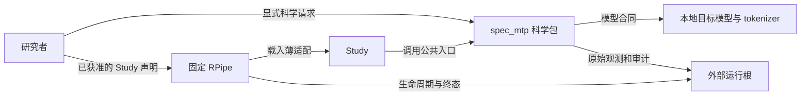
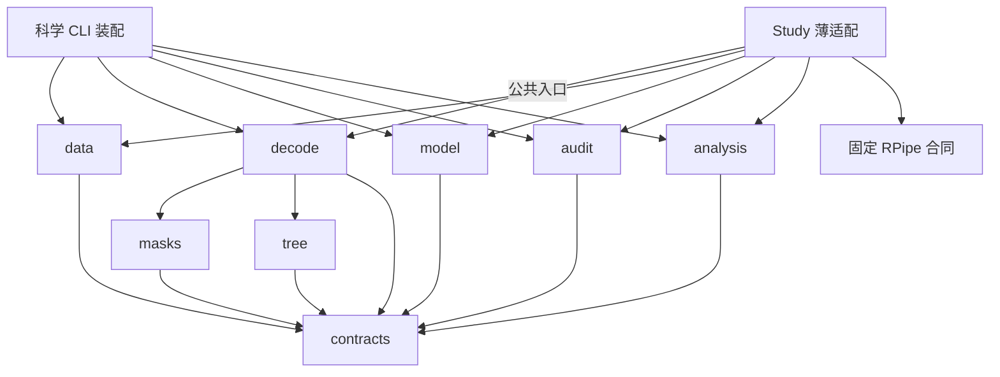
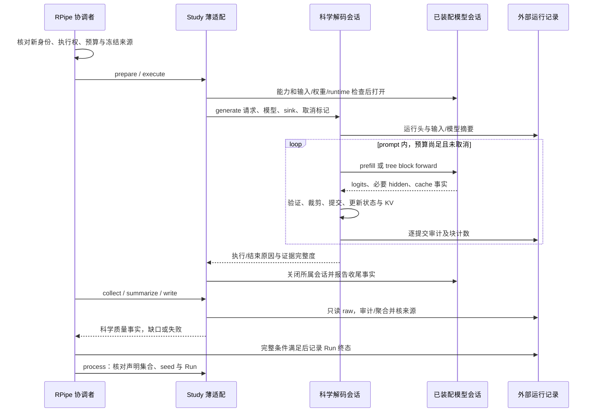
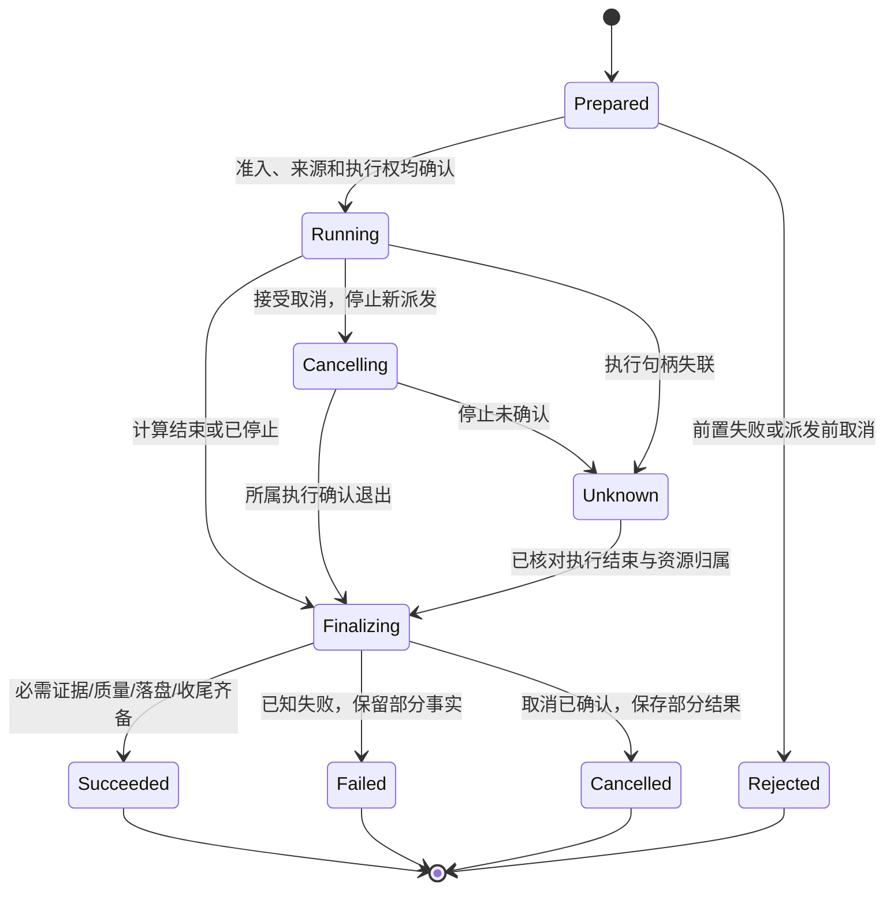

**去噪推测解码 架构设计**
更新日期：2026年10月21日。状态：目标设计，尚未实施。机制与历史证据见 [通用调研](<去噪推测解码 通用调研.md>)，目标落位见 [代码结构设计](<去噪推测解码 代码结构设计.md>)，实验范围见 [研究计划](<去噪推测解码 研究计划.md>)。

# 一、从研究目标推导架构
## （一）目标、上下文与约束
研究系统将冻结输入、模型与解码条件变成候选、验证提交、原始审计和可解释对照。首要目标是研究结论可靠：能定位每个提交来自哪个验证前向，来源变化会被拒绝，负结果和中断不会被改写成成功。其次是用相同科学入口比较 mask、树和预算，避免每个 Study 复制解码器。

这是目标上下文/交互图，箭头表示使用或数据写入，不表示 import。科学包独立于执行框架，Study 适配向 RPipe 提交科学事实，执行终态由 RPipe 协调者决定。源码目录、逻辑模块和进程分别描述。

当前授权为文档设计与 Draft PR，不执行架构。所有科学源码、测试实现、正式配置、原数据及两处第三方树保持原状。新模型实验、代码重构、兼容命令变化和数据删除均另行按当前用户范围处理。
## （二）具体质量场景
| **编号与目标** | **触发、期望响应** | **边界与验收信号** |
| --- | --- | --- |
| Q1 科学正确性 | 变更 mask/树，提交链仍可对应验证行 | 同次 T0 argmax 全覆盖，拒绝 draft 不更新长期状态，KV 仅保留接受路径 |
| Q2 来源可追溯 | 输入、权重、源码或配置在 make 后变化 | 加载/执行前拒绝可检出的漂移，定稿再查实际来源；零解码调用或明确标出执行后漂移，旧原件不覆盖 |
| Q3 结果真实 | execute 完成但审计缺行、写满或聚合失败 | 执行完成、证据完整、数学门、论文差距分别呈现，Run 不伪成功，旧摘要不覆盖 |
| Q4 可修改与复用 | 换 mask 或模型接入，Study 因素不同 | mask 变更限科学模块与测试，Study 不复制 decoder，宿主不导入 RPipe/Study |
| Q5 可取消与恢复解释 | 阶段间取消、forward 中超时或进程失联 | 停新派发，保留执行句柄和已提交事实，确认退出才结束占用；未知不盲目重试 |
| Q6 资源有界 | 多任务争同一 GPU 或输入越预算 | 一个获准队列串行，先查资源和有限配置，拒绝后不加载模型；耗尽时保留部分结果 |
| Q7 离线可读 | 只看历史结果/比较，无模型与 GPU | 读端零 forward/下载/launch，不以当前默认值替换旧记录口径 |

延迟、显存和超时阈值在具体设备/计划实测后确定，当前不编造性能门槛。自检、AR 等价、采样分布和速度收益的差别沿用通用调研。
## （三）规模与组织选择
首选单机模块化科学包，加同进程 Study 薄适配；RPipe 负责受控执行过程。数据、模型接入、解码、审计、分析是需要独立验证的责任，不按“层数齐全”增加服务、注册中心、事件总线或存储平台。

模型通常在一个受管子进程中使用 GPU。CLI、Study 和科学模块数量不决定进程数量。尚无跨设备服务或多模型调度需求，不建设微服务与通用插件框架。

# 二、构建块、合同和状态归属
## （一）黑盒责任
| **责任** | **提供与需要的合同** | **权威状态与隐藏细节** |
| --- | --- | --- |
| 输入 `data` | `read_prompts`、`encode_prompts`，显式 tokenizer 与输入条件 | 有效 qid/顺序/token/EOS 及数据摘要；不决定实验因素或执行排程 |
| 模型接入 `model` | 打开/关闭会话、能力、prefill/block forward、embedding 与所需 hidden | 拥有具体 HF 模型/tokenizer/device 与原生 cache 资源，不宣布研究成功 |
| 解码 `decode`、`masks`、`tree` | `generate`，借用模型会话、mask 策略、审计 sink、取消标记 | 一条 prompt 会话独占 committed 前缀、KV 逻辑长度、RNG、mask 长期状态与块内 proxy |
| 科学审计 `audit` | `audit_run`，原始提交观测、来源声明与实际摘要 → 分维度 verdict | 定义提交覆盖、owner/row、计数和来源一致性规则；不改 Run 终态，不补造缺失 raw |
| 分析 `analysis` | `summarize`、`compare`，已准入科学记录 → 指标与逐 prompt 对照 | 无活动执行状态，固定统计口径和缺口，不读取日志推断成功，不发起模型 |
| Study `structure/flow` | 将 RPipe 载荷/阶段上下文转换到上述公共入口 | 只保存本研究特有因素与格式映射，不拥有第二套队列/Run 状态 |
| 固定 RPipe | 计划、执行权、六阶段、取消、记录终态与读取 | 唯一拥有 Run 生命周期、进程句柄、运行目录和整体执行结果，文档目标不表示当前 pin 已实现全部语义 |

共享数据和模型最小接口在 `contracts.py`，不创建每个函数一层抽象。一次 decode 会话拥有科学可变状态，模型具体 cache 句柄由其接入管理，解码器决定只保留哪些语义位置。`audit` 返回质量事实，Study 映射到 RPipe，双方不各维护最终 success。
## （二）公共数据与入口
| **合同** | **输入 → 输出** | **前置、后置与副作用** |
| --- | --- | --- |
| `generate(request, model_session, mask_policy, sink, cancel)` | `DecodeRequest` → `DecodeResult` | 有效单条 token 输入/配置、能力与新输出身份；按序前向并写观测，退出保留已提交 token，收尾不伪装完成 |
| `audit_run(raw, expected_sources)` | 原始观测和显式来源声明 → `AuditResult` | 仅读，拒绝版本/范围/哈希不符，缺 token/owner/行即不完整，失败原因分项返回 |
| `summarize(records, protocol)` | 完整/部分记录和原统计口径 → `Summary` | 纯计算，缺失项显示，不擅自排除不利 prompt，不将短输出 calls 当等长加速 |
| `compare(left, right, pairing)` | 同因素要求下的记录 → 配对结果 | 先核 qid/输入/协议/输出长度差异，再计算胜平负；不可比时给原因 |
| `ModelSession` | 能力、forward 请求与 cache 操作 → logits/必要 hidden/实际资源事实 | 打开才加载，明确 device/dtype/backend/context/tied-storage，close 只关闭本会话资源 |
| `ObservationSink` | 运行头、逐 prompt/块/提交记录和结束事实 | 写入者确认落盘结果，失败报告给调用者；不提供自动 launch 或补跑 |

`DecodeRequest` 包含实际 prompt IDs、EOS/最大长度、树/槽/方法配置、随机条件和来源标识。`DecodeResult` 分开 execution、termination_reason、committed、计数、raw 位置与 evidence_complete。`AuditResult` 分开 source_integrity、argmax_coverage、argmax_correctness、AR_diagnostic，不将论文目标比较塞入同一个 bool。

`ModelSession` 是进程内替换/假调用边界，不是网络协议。真实实现可以保留现有 HF 机制，假实现提供可控 logits 和 cache 观察。能力缺失即拒绝，不自动切换精度、后端、模型或云端。

`mask_policy` 由装配或 Study 为每条 prompt 创建，提供初始化、块内预测和提交后更新，声明是否需要 normalized hidden。decoder 只使用其行为合同，不按 Study 名加载类。输入/输出 provider 保留不同的实际观测需求，不强制制造无用 hidden。K 独立 Study 可在该明确边界试验仿射校正，不通过 monkeypatch 或复制 decoder 改科学流程。
## （三）科学不变量
- 每条生成有独立 committed 状态与 RNG，prompt 切换后不残留上一条 mask/KV。prefill 产生首 token，不能被漏审
- 仅实际提交 token 更新 input mask 长期历史；输出长期状态仅使用已提交位置的真实 normalized hidden。预测 proxy 和块内模拟只活在当前块
- 树节点有稳定 parent/depth/position/owner 映射。验证接受路径、bonus 与 mask-logits seed 在同一映射下解释，错误 owner 即失败
- EOS/预算裁剪后 committed 与 raw 审计一致，accepted、committed、prefill、decode_calls、total_calls 各自计数，不补默认0掩盖缺字段
- 保留 KV 的路径和 `cache_len/root_pos` 对应，不能把被拒节点或未提交 bonus 当缓存。模型接入检查实际 context 容量
- T0 每个提交 token 都关联其真实验证 forward 的 argmax，审计不能事后用新 forward 补证旧行。非 T0 不冒用 T0 正确性合同
- 独立 AR 可分叉，诊断保留首差异/长度；不能因差异自动重跑，也不能删除负例改写统计母数

# 三、源码依赖与运行时调用
## （一）目标 import 方向

箭头仅表示 import/类型引用。解码通过注入模型会话进入具体接入，源码不导入 HF 接入。科学包不导入 `rpipe`、`studies` 或 `tools`。数据与模型不导入解码，审计/分析不导入模型，科学模块不写 Study 的 process/result。跨研究复用进入宿主公共入口，Study 内部私有函数不被宿主反向导入。

目标具体文件与允许依赖只在 [代码结构设计](<去噪推测解码 代码结构设计.md>) 维护。Import Linter 草案用于静态边界，不证明动态导入、数据泄漏、状态或数值合同正确，当前未安装/配置。
## （二）一次完整研究运行

这是满足前提的目标运行路径。来源预检、资源准入、输入校验失败都应是零模型调用。运行后来源漂移、sink 写失败与 close 失败分别保留，不抹已发生的 forward 或已提交 token。process 只核对实际声明集合，不从成功子集推完整矩阵。

# 四、执行、取消、恢复与部署
## （一）分开 Run 与 prompt 状态
Run 生命周期权威在 RPipe，科学 decode 只报告本条计算的进展与结束事实。下图是期望协调语义，当前 v0.3.1 pin 尚未实现全部目标，不能据图称已具备强取消和外部运行根。

取消不是回滚。forward 中无法立刻停止时，保留忙状态和所属句柄，等待当前调用返回再拒绝下一块；需要硬终止仅由拥有 worker 的协调者执行，不能结束其它项目进程。未知运行不得继续占用同一输出身份或设备执行权。

恢复先依据持久化记录识别完整/部分/未知，核对原始文件与进程状态。研究当前没有任意 KV/mask/RNG checkpoint 恢复保证，不能把 RPipe 阶段恢复当 token 中途续算。确需重试时用新的运行身份并明确从何处重算，保留旧失败；旧成功 Run 不 make/remake 重签。
## （二）部署与资源
| **运行单元** | **职责与边界** |
| --- | --- |
| 研究者 CLI/本地协调进程 | 读计划、核范围、调 RPipe 或科学入口，读端无执行权。普通 import/help 不加载模型 |
| 一个受管执行 worker | 加载模型及 tokenizer，逐条 decode，同进程科学模块与 Study 适配，拥有其 CUDA/cache/文件句柄 |
| 单台主机/GPU | 已获准队列串行，资源准入以实际 CUDA、显存、host 峰值加2GiB等已确认条件为准，不抢占别的任务 |
| 源码 checkout | Python 包、固定副本、研究声明、原始静态数据与四文档，保持可审阅和可打包 |
| 显式外部运行根 | 独立运行身份下的冻结快照、raw、来源/审计/汇总、诊断日志和终态，不回写源码 Study docs |

外部运行根分离是与 RPipe 目标合同一致的后续能力。当前 v0.3.1 仍默认把 `runs/shared` 放 Study 下，本轮不改 pin 或配置来假装完成分离。未来采用兼容版本前必须验证路径、锁、续算、CLI 与证据读取，不用自建第二套 runner 绕过框架。

# 五、证据、输入与故障合同
## （一）输入信任边界
CLI、YAML/JSON、token 数据、Hub 文件和旧运行记录都校验形状、版本、大小/数量、有限数值、允许范围、路径归属与来源。布尔不作数值，NaN/Infinity 不进指标，qid/序号重复或混 Run 必须报错。能力、格式或输入缺失不得静默回退到另模型/精度/默认 prompt。

模型 cache 的原生数据不作为公共结果传给读端。外部提供的路径限制到明确输入/运行根，路径含中文/空格可正常使用。tokenizer、chat template、thinking、EOS、context 与停止条件都是输入合同的一部分。模型名相同不代替实际内容 digest，未知 immutable revision 不伪填当前 HEAD。
## （二）业务证据与日志
冻结运行头记录 schema、执行提交/差异、固定 RPipe、Study/配置/计划 commit/blob、输入/模型/runtime/随机条件、预期矩阵和 raw 位置。逐 prompt/块/提交观测保存 forward/row/owner、token、验证 argmax、accepted/committed、cache/停止与实际计数。必要 evidence 写失败立即停止下一前向，保留已执行事实。

原始结果、摘要与终态之间没有跨文件事务保证。先写临时文件、校验后原子替换适用于单文件保全，不保证整套运行原子提交。缺结束记录或 raw 截断即未确认，不能因行数看似齐全推正常完成。重算另存分析版本与输入哈希，不能覆盖旧结论。

诊断日志采用现有 logging 及 UTF-8 JSONL，包含 timestamp/level/event/logger/message/app_name/app_version/runtime_id/process_name/pid，按场景加 Run/phase、outcome 和实际耗时。未知可选项省略，凭据、prompt 正文和完整 tensor 不进普通日志。sink 故障记录实际影响，日志无错误不能作为成功依据。
## （三）失败处理
| **故障** | **处理与继续条件** |
| --- | --- |
| 输入、冻结来源或资源前置拒绝 | 零 forward，不生成成功结果，不自动改因素/精度/数据规模绕过 |
| 模型加载或前向失败 | 保留阶段、异常与已执行部分，关闭所属资源。OOM 不自动重试同身份 |
| 原始证据写满/截断 | 停下一块，返回证据不完整，已发生 token 不伪称未执行 |
| 数学门或来源复核失败 | 保留 raw、失败原因和旧摘要，不进入成功定稿与依赖实验 |
| 独立 AR 失配 | 记录首分叉和长度，仅诊断，不当成重试触发器 |
| 终态写失败或 worker 失联 | 结果待核对，禁止同身份重放，先恢复事实与资源归属 |
| 读端损坏/版本未知 | 明确不可比较或不完整，零模型/排程调用，不按新默认悄悄修数据 |

# 六、Study、科学包与固定副本
Study 的 `study.yaml` 说明因素、seed、扩展及冻结声明，`experiment_config.yaml` 提供基础配置。`structure/` 只放该研究确需的载荷接入/纯计算，`flow/` 只覆盖实际特有阶段。prepare/execute/collect/summarize/write/process 六阶段继续复用，缺职责不创建空文件或复制全库。

研究问题和实验安排只在唯一中文研究计划按 Study 分章，结果只在通用调研保留必要摘要与固定原件定位，执行 raw 和可重建报告在外部运行根。Study、测试和工具不再规划 README、PLAN、NUMBERS 或逐事报告。测试排除项和入口说明留本文与代码结构设计。

共同合同对齐2026年10月21日 RPipe 文档重设计的 [研究流水线 架构设计](https://github.com/DreamSoul-AI/RPipe/blob/codex/docs-architecture-rpipe-20261021/docs/研究流水线%20架构设计.md) 第五章。其目标语义不是 SD 当前固定副本能力；引用分支只用于待评审设计，后续采用应改为经确认提交。固定 `src/rpipe/` 不在本仓修补，通用问题在上游独立修复后另行完整同步，包含源码、许可与来源。

当前 `python -m spec_mtp` 的 RPipe 代理与 console API 有兼容消费者。目标科学 CLI 提供显式 decode/audit/compare，Study 执行使用 RPipe 入口。旧 make/launch/process 等的保留、转发或弃用需实施前逐项确认，不能在纯文档阶段承诺参数兼容，也不能因此让科学宿主依赖框架内部。

已选的 `affine_residual_correction` 目标 Study 先以 CPU 小样本验证 K=[A,b]，再封存 K 跨数据集比较无校正、仅 bias 与完整校正。拟合、冻结与应用分开，测试数据不得进入 K 估计或选型。校正残差的 m/y/位置和可见时刻必须先定义，起草时不可访问未来 y。该研究特有方法先在 Study `structure/` 落位，公共解码/审计复用宿主；真正形成跨 Study 复用后再考虑进入宿主，不预建通用校正框架。当前 dev 无该 Study 实现，本轮不执行。

# 七、验证、测试与 CI/CD
## （一）合同到用例
测试镜像目标 Python 结构，unit/integration/e2e 是标签。每项一个主要信号，逐参数独立标识，不用一个“全树正确”大断言锁死临时结构。

| **目标与路径** | **最小输入/故障** | **必需信号** |
| --- | --- | --- |
| data → 科学请求 | 中文、空 prompt、重复 qid、EOS/模板漂移、越 context | 明确拒绝/来源，零模型调用，不换输入 |
| model 合同 | 假 logits/hidden、无 tied、后端/精度不符、close 失败 | 能力检查、资源所有权与原始失败保留 |
| decode → mask/tree/model | 微型可枚举模型、错 parent、bonus/EOS、拒绝路径 | 完整 token/owner/row、KV 不变量和状态只随提交更新 |
| masks | 零范数、非有限、首差分、冻结更新、proxy 模拟 | committed 不被污染，初始化/β/γ/slot 语义与既定合同一致 |
| audit → raw | 缺首 token/行/owner、哈希漂移、重复/混 Run、坏记录 | 拒绝不完整与损坏，AR 差异只诊断，零 forward |
| analysis → 配对 | pooled/均值不同、缺 prompt、长度不同、负例 | 固定母数/口径，保留胜平负与不可比项，不擅作速度结论 |
| Study/RPipe 集成 | 来源拒绝、单 Run 故障、取消、process 子集 | 宿主入口被调用一次，唯一协调权、首错与终态保存，旧成功字节不变 |
| 用户科学 CLI 旅程 | 显式 decode/audit/compare、无参数/help | help 零载模，假模型贯通到可见结果；审计和比较零启动 |

假模型和可枚举 CPU logits 为低成本关键门。真实 tiny BF16、目标4B/8B、CUDA/cache/ABI、包安装和资源行为分别验证，假调用不能代替真实模型证据。第三方原树只核来源字节及明确适配合同，不纳入本仓任意格式化或未来源文件镜像改造。
## （二）计划、元数据与结果
保留 pytest，未来最小执行适配复用其选择和逐项结果机制，不重造测试框架。静态配置声明 test_id、level/type/cost_class/result_type/priority、目标/tags 和 result_detail，逐参数/attempt 独立。测试说明和排除项在本文维护，不新增 tests/README。

快速计划选受影响 P1/P2、C1 的离线数据/状态/审计项，回归计划扩至相关 C2 和假模型集成。真实 GPU 至少 C3，大矩阵 C4，须明确设备、单项/整批时间与内存/显存预算、配置数量、重复、并发及停止规则。当前没有实测预算不编数字；旧 GPU 计划暂停，不借测试名恢复研究。

结果逐项落盘到独立验证根，含 run_id、plan_id、test_id、attempt、五维、环境/源提交/基线、status、verdict、metrics、cost、duration、failure 和 artifacts，保留 setup/call/teardown。纯测量 `measured/verdict=null`，有质量门才 passed/failed，error/timeout/missing 和不允许的 skipped 阻断。中断可从已存记录重建部分报告，不用“已执行子集通过”替代完成。
## （三）当前未完成项与发布边界
本轮只进行静态文档/链接/范围及离线 P01。旧 `test_docs_index.py` 读 `docs/layout.md`，`test_docs.py` 固定双语计划/归并 manifest，部分 Study provenance 和分析器引用已删除运行证据；测试/配置保持未改，预期不能全绿。后续实施须改真实合同和消费者，不保留重复文档骗过字符串测试。

当前 Actions 的 `cpu-checks` 在 PR 及其既定分支运行 Ubuntu/Python3.12，Branch flow 检查工作分支 → dev → main。本轮不改工作流、保护、pin 或自动合并。未来按受影响合同、本地假路径、包安装和必要 GPU 条件分阶段验证，结果绑定实际提交、目标基线、环境及交付文件哈希。源码测试与构建完成不代表已发布。

# 八、必要性、代价与实施顺序
| **决定** | **解决场景与不增加的后果** | **成本与升级条件** |
| --- | --- | --- |
| 标准科学包独立于 RPipe | Q4，避免每个 Study 复制/改同一算法 | 公共合同与一层薄适配成本；跨研究有真实共用时进入宿主，不建通用注册平台 |
| 一个 decode 会话拥有科学状态 | Q1/Q5，分散 KV/mask/RNG 容易错位和串样本 | 会话生命周期测试；只有明确并发需求才增多会话调度 |
| 模型最小合同 | Q1/Q4，真实加载与假验证需分离 | 少量数据与能力映射；新增后端语义不等价就修改合同，不静默转换 |
| 审计和分析分开 | Q3/Q7，计数完成不能代替原始正确性 | 维护两组纯规则，避免读端加载模型；无需独立数据库或服务 |
| 独立运行根与单协调者 | Q2/Q5，源目录写运行物与双启动破坏身份 | 需上游兼容实现与迁移验证，当前仅目标，不在下游复制 runner |
| 正文少量视图与依赖草案 | Q4，能评审源码/行为/部署而不混箭头 | Mermaid 与人工合同复核，出现持续边界维护成本后再接工具，不全套 UML/C4/arc42/OCL |

实施候选顺序为：先冻结科学合同与可枚举 CPU 反例，再迁移纯 mask/tree/analysis，随后迁移 model/decode/audit 与测试镜像，最后改 Study/CLI/来源与运行根接入。每步核对实际 token/计数/错误行为，不能把目录移动本身当行为等价。旧消费者、静态配置及测试需随实际改造完整更新，删除其它源码或数据仍先核用户范围。

方法依据为关联 DreamSoul 架构设计四资料、CPU 内存清理固定样板及已读取研发规范，具体范围见通用调研第七章。质量场景、黑盒表、源码/运行/部署与简约取舍是本项目裁剪，没有执行正式 ATAM 或标准符合性认证。本文描述待评审目标，不表示实现、实验和 CI 已完成。
