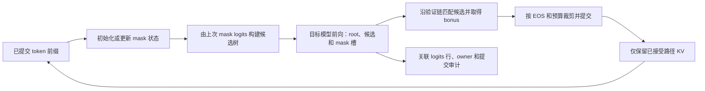

**去噪推测解码 通用调研**
更新日期：2026年10月21日。中文名为建议名。研究范围为免训练多 token 预测、ESP、输入/输出掩码及接受验证。本文集中维护机制与实际证据，目标合同见 [架构设计](<去噪推测解码 架构设计.md>)，后续实验见 [研究计划](<去噪推测解码 研究计划.md>)。

# 一、核心问题与结论
本项目要回答：没有辅助训练或额外起草模型时，怎样从同一目标模型获得多个候选，哪些掩码与树结构能提高接受效率，以及什么证据足以支持正确性和收益判断。

现有结果支持在固定条件下比较接受数与调用数。8B 非官方独立复验三格数学自检通过，但 BC30/60 未复现论文目标。4B 五方法中输入一阶总量最好，输出一阶没有稳定联合优势。同范数随机偏置也能改善零偏置基线，尚不能把范数认定为唯一机制。历史结果不是新的执行指令。

# 二、方法地图与已有实现
## （一）起草方式是主要分类轴
自回归逐 token 生成先得到一个可靠参照。推测解码再把“提出多个候选”和“按目标模型确认候选”分开，让一次目标前向覆盖更多可能续写。Leviathan 等的原论文研究辅助模型与保持目标分布的采样方法，Chen 等采用修正拒绝采样，二者的分布论证都有算法与数值前提。本文此次只重读摘要，没有重证其理论。[Leviathan v2](https://arxiv.org/abs/2211.17192v2)、[Chen v1](https://arxiv.org/abs/2302.01318v1)

| **路线** | **候选来自哪里** | **主要成本与限制** | **本项目位置与直接来源** |
| --- | --- | --- | --- |
| 小模型起草 | 独立较快模型提出短续写，目标模型验证 | 额外模型、内存、对齐与采样合同 | 概念对照，未实现。Leviathan/Chen |
| 多预测头 | 同一主干增加多个未来 token head，再作树验证 | 需要头训练，部分方案同时微调主干 | Medusa-1/2 的训练范围不同，本仓未集成。[论文 v3](https://arxiv.org/abs/2401.10774v3) |
| 特征外推 | 在目标模型特征上预测后续表示，再构造候选 | 需要专门模型/训练和精确特征合同 | EAGLE 官方仓提供相关实现，不能等同本仓 EMA。[官方 README](https://github.com/SafeAILab/EAGLE#readme) |
| 历史 token 检索 | 从已有输入/上下文匹配 n-gram 后续 token | 受重复度和任务影响，仍须验证 | PLD 是免训练、无独立神经起草器的比较路线，本仓未实现。[原作者项目](https://github.com/apoorvumang/prompt-lookup-decoding#readme) |
| 同模型 embedding 探测 | 给冻结模型注入合成 embedding，读取未来候选并验证 | 树/槽增加前向工作量，候选质量受表示与结构影响 | ESP 是最接近基线，本仓是非作者官方实现。[ESP v2 §3](https://arxiv.org/html/2603.17942v2#S3) |
| 输入/输出 EMA 掩码 | 用已提交 embedding 或隐藏状态构造零/一阶预测 | 状态更新、范数、代理与映射引入不同假设 | 本仓研究方法，性能与新颖性限于现有证据，见第三章 |

树形与链形是候选组织轴，T0/采样是验证轴，静态/动态是预算分配轴，三者分别影响接受与执行开销。免训练只说明不新增训练，不能由此推断无额外算力、无需验证或适用于所有模型。
## （二）ESP 与本地技术路径
ESP 用 prompt embedding 均值初始化 mask，生成时按新 token 以 λ 更新；同向量在不同位置及上下文产生不同预测。候选按累计概率构成树，剪枝替换父子连续重复 token。论文提供静态 attention/position 优化，正文与 Table 1 的输出长度/硬件描述需按实验分别对齐，不能拼成统一合同。[ESP v2 §3、Table 1](https://arxiv.org/html/2603.17942v2#S3)

下面解释本仓当前实现，不作为作者源码的转述。mask 是直接拼入 `inputs_embeds` 的连续向量，没有先反查词表 ID。前向输出 logits 才产生候选 token。一次块包含 root、候选树及每个节点的 mask 槽，大小为 `(k+1)×(1+ΣK_i)`。本地单槽 BC30 对应14草稿节点，双槽 BC30 对应9节点，BC 相同不代表树相同。[当前解码器](../src/spec_mtp/decode.py)、[树构建](../src/spec_mtp/tree.py)

图为本地机制分析，箭头是数据和处理顺序，所有框首先在同一解码进程。prefill 先计算首 token 与首棵树的 seed；后续每步验证接受路径并产生下一棵树 seed。被拒 draft 不能进入长期 mask 历史，bonus 在下一步作为 root，步后 `cache_len == root_pos`。验证、缓存剪裁和下一步 seed 归属必须一起核对。[当前解码器](../src/spec_mtp/decode.py)、[KV 操作](../src/spec_mtp/model.py)

# 三、掩码状态、观测与验证语义
## （一）输入 embedding 的零阶与一阶
当前 ESP provider 的均值更新为 `m ← (1−λ)m + λe_new`，对每个已提交 token 依次执行。`update:false` 冻结 prompt 均值，last-k、sample embedding 和偏置初始化是不同消融。采样初始化用生成器 fork，避免初始化噪声消耗正式采样流。[mask_providers.py](../src/spec_mtp/masks.py)

当前输入速度为 `v ← βv + (1−β)(e_new−e_prev)`，mask 槽为 `origin + γi·step(v)`。prompt 第一差分播种后依序更新，没有 Adam 式偏差校正。`origin` 可为末 token 或按 λ 更新的均值；β=.9999 的记忆保留特性取决于播种与后续长度，不能只用 β 数字说明效果。`normalize` 使用差分范数 EMA 定尺度，`extrapolate_ema` 仅模拟块内状态，不污染 committed 状态。速度关闭仍可更新 last anchor 与零阶均值。这里 γ 是步长尺度，不叫 slope。[同一源码](../src/spec_mtp/masks.py)
## （二）输出隐藏状态的预测与映射
当前 `OutputHiddenMaskProvider` 观察 final normalized hidden，内部 anchor/velocity 以 FP32 保存，模型前向与最终 mask 可为 BF16。已提交真实隐藏状态更新长期 anchor，速度衰减 β；块内 proxy 以 β′ 模拟 owner 状态，生成不同深度的预测。临时 proxy 不能写回长期 committed 状态。[output_masks.py](../src/spec_mtp/masks.py)

其映射为 `Φ(z)=s·z/||z||`，`s` 为输入 embedding 表平均行范数，拒绝非有限或零范数。tied embedding 与输出 head 的实际共享存储是现有输出路径前提，不能只看模型配置的布尔标记，也不能把归一化映射叫逆模型。序列/owner 对齐错一位，就可能用错 proxy 预测下一树，即使类型形状相同。[映射实现](../src/spec_mtp/masks.py)、[模型接入](../src/spec_mtp/model.py)

EMA 可平滑历史变化，但这本身不提供噪声观测模型、协方差、Kalman 增益或最优估计证明。“去噪推测解码”为项目建议名，本仓未实现 diffusion 去噪模型或 Kalman 滤波。输出一阶的直觉需要由配对负例和状态干预检验，不能由公式名称认定成立。

Enmao 于2026年10月20日20:57确认的 K=[A,b] 路线采用 `z′=z+A[e(y)−e(m)]+b` 仿射残差校正，独立 Study 先做 CPU 小规模，再冻结 K 检验跨数据集，无校正/仅 bias/完整 K 三臂。该选择是最新研究决策，当前基线未含实现和新结果，不把旧分支来源当当前代码。仿射校正与真正 Kalman 的协方差/增益递推分开，尚未证明 data-independence 或命中率提升，具体对齐与防泄漏合同见研究计划第五章。
## （三）四种正确性与效果问题
| **问题** | **需要的证据** | **现有范围** |
| --- | --- | --- |
| 提交是否服从这次验证 | 提交 token、forward/row/owner、argmax、输入/输出哈希与完整覆盖 | T0 正确性门已实现，历史结果在第五章，当前未重跑 |
| 是否等于独立 AR | 同模型/输入/预算的完整独立序列、首分叉与长度 | BF16 历史有大量差异，只诊断；不以自检覆盖它 |
| 随机采样是否保持目标分布 | 明确算法前提、随机数合同、分布推导与适当验证 | 本仓未完成一般保证；共享 generator 的路径观察不足以单独证明 |
| 是否实际更快/更省 | 同质量与输出协议、硬件/预热/同步、完整端到端时长/资源 | 此阶段不测速，零计时占位不作测量 |

验证前向形状与逐 token AR 的浮点路径可能不同，是现有差异的候选解释，不是本轮完成的因果归因。缺原始 logits/审计时，摘要 JSON 与模型名都不能补证原始 argmax。保留负结果比事后更换成功门更能限定结论。

# 四、实现来源、取舍与当前证据链
## （一）三类实现严格分开
本仓的 `spec_mtp` 是非作者官方研究实现；第三方 HF 代码固定为 `ad76f8da29f3bfc7faa20488193c6aa83a9f708c`，原 README、四份 code 和三份 results 全部保留，来源清单为 [ORIGIN.json](../src/spec_mtp/structure/algorithm/reference/esp_reproduction_artifacts/ORIGIN.json)。该来源历史未附 LICENSE，许可状态保留未确认，不据此扩大使用许可。2026年10月21日直开 HF 固定页失败，本轮未更新该远端状态。[HF 固定来源](https://huggingface.co/datasets/Harshvardhan-Mestha/esp-reproduction-artifacts/tree/ad76f8da29f3bfc7faa20488193c6aa83a9f708c)

历史作者入口核查未取得可运行原生代码，后续已明确停止追找。2026年10月21日重读论文与代表方法公开入口用于技术调研，没有重启作者入口搜寻、下载模型或执行第三方算法。不能由“未核验到”断言作者从未开源。
## （二）当前源码职责与目标差距
当前 CLI/Study recipe 注册 RPipe 的 Data、Model 和 Algorithm，默认 prepare/execute 复用库，专项 collect/summarize/write/process 计算和核验证据。RPipe 通用 provenance 不直接覆盖 Study 外的 `spec_mtp`，专项 `sources.py` 为其记录额外源码锁。模型输入、权重 digest、tokenizer/runtime 和原始输出在最终验收前复核。[来源锁](../studies/_shared/structure/sources.py)、[证据](../studies/_shared/structure/evidence.py)、[验收门](../studies/_shared/flow/summarize/run.py)

这些是当前代码事实，不意味着分层已符合目标。科学代码、Rpipe 接入和运行证据目前交叉在 `structure/flow`，目标要把科学包与执行框架隔离。设计保留现有算法语义与固定 pin，避免为了目录改造引入另一执行器、状态库或插件系统。

离线核验 P01：2026年10月21日仅取 `tools/diagnose_output_windows.py:file_hash` 的 AST，在隔离命名空间以禁止子进程的假调用检查。原数据哈希正常，旧计划路径触发已删除 `plan-consolidation-manifest.json` 的 `FileNotFoundError`，子进程/模型/GPU 调用均为0。这确认清理后的旧消费者确有未迁移项，没有修改实现或把预期失败记成全量通过。
## （三）设计输入
| **约束** | **为什么保留** | **最小设计响应** |
| --- | --- | --- |
| 科学行为与生命周期分离 | 来源拒绝、复算和取消不应改变 token/状态公式 | 科学包提供生成/审计/分析合同，Study 薄适配执行 |
| committed 与 proxy 状态分开 | 拒绝候选或模拟状态不能泄漏下一轮真实历史 | 解码会话独占 KV、mask、RNG，审计 owner 与行 |
| 原始证据和摘要分开 | 聚合数字不能证明原始前向正确 | 运行根保留 raw，正文只维护必要摘要与原件定位 |
| 质量与进度分开 | execute 完成、来源完整、数学自检、论文目标分别可能失败 | 多维结果不压成一个 success/complete |
| 先满足当前研究规模 | 尚无远程伸缩或多后端平台需求 | 单机模块和一个执行协调者，不建服务与通用插件市场 |

# 五、历史结果的有效矩阵
## （一）8B 非官方 Table 1 独立复验
固定 SpecBench480、Qwen3-8B、BF16/T0、seed123、256/EOS、λ=0.1 更新均值、动态树剪枝、单 mask。BC10/30/60 的最大草稿节点为4/14/29。正确性门为每个提交 token 等于其验证前向对应 logits 的 argmax，覆盖首 token、owner、行位置、完整提交链和哈希。独立 AR 一致率只诊断。

| **BC** | **pooled τ** | **prompt mean τ** | **category mean τ** | **论文对照** | **自检 token** | **AR exact/480** |
| --- | ---: | ---: | ---: | ---: | ---: | ---: |
| 10 | 1.399047031 | 1.431765889 | 1.403033561 | 未指定 | 79,757 | 188 |
| 30 | 1.563377504 | 1.593232237 | 1.563387272 | 1.63 | 79,762 | 175 |
| 60 | 1.647301264 | 1.669498033 | 1.649693144 | 1.74 | 79,618 | 185 |

三格原生 Run 与 Study process 历史记录为成功，合计239,137 token 自检通过。BC30/60 距论文−0.066622496/−0.092698736。三种聚合均未达到对应目标，独立复验与旧完整结果逐 prompt 计数相同。来源为下方 H01，不是本轮重新执行。

pooled τ=Σ解码阶段实际提交 token/Σdecode calls，prefill 首 token 不进分子分母。prompt mean 为逐条等权均值，category mean 先在类别内 pooled 再类别等权。作者任务权重尚未确认。接受数可能在 EOS/预算裁剪前计算，不能与裁剪后 committed 混用，也不能把 τ 当实测加速倍数。
## （二）4B BF16 五方法加 AR
固定480条、seed123、BF16/T0、256/EOS，双 mask 动态剪枝树，BC30/60 对应9/19草稿节点。五方法×两预算加单次 AR 共11个 Run 完成，10个 Spec Run 共809,118提交 token 的 argmax 自检通过。以下为 pooled τ，完整比较在 H02 的固定历史原件。

| **方法** | **BC30 τ** | **BC60 τ** | **BC30 accepted / 总 calls** | **BC60 accepted / 总 calls** |
| --- | ---: | ---: | ---: | ---: |
| frozen mean | 1.402894760 | 1.499078504 | 23,188 / 57,825 | 26,913 / 54,197 |
| 输入零阶 | 1.422420206 | 1.519108823 | 23,926 / 56,938 | 27,523 / 53,309 |
| 输入一阶 | 1.511957584 | 1.636339710 | 27,371 / 53,668 | 31,611 / 49,875 |
| 输出零阶 | 1.433178245 | 1.528922466 | 24,382 / 56,577 | 27,828 / 52,896 |
| 输出一阶 | 1.435539512 | 1.529835528 | 24,573 / 56,716 | 27,903 / 52,951 |

总 calls 包含 prefill，与 τ 的分母不同。输出一阶相对零阶在 BC30/60 accepted 增191/75，calls 也增139/55，输出 token 增332/132，prompt mean τ 均下降。两输出方法对均值基线有小幅总量改善，仍弱于输入一阶。不同长度/轨迹、β 和内部状态精度构成混杂，单 seed 固定480条不支持纯空间因果、普遍优势或速度结论。AR 一致范围161–184/480，只作诊断。
## （三）偏置方向与范数
4B BF16/T0、固定480条、BC30 六格方向对照完成，485,860提交 token 自检通过。e2−e1 的 τ=1.507777653，同范数随机三 seed 为1.495188134/1.464349086/1.523884714，均值1.494473978。零偏置为1.422420206，内容初始化为1.364829262。来源 H03。

随机方向反驳“只有 e2−e1 有效”，不能证明任意方向等效。内容初始化同时改变后续更新，不能当成纯方向实验。范数倍率0.5×仅首格完成，τ=1.471389646，80,940 token 自检通过，collect 故障修复后没有重跑 execute。余七格和后续11格独立配对暂停，未完成范数曲线。来源 H04。
## （四）探索结果与失败边界
| **研究主题** | **可复用认识** | **不能外推的内容与原件** |
| --- | --- | --- |
| 4B FP32 输入 EMA | first26 frozen/updating/长记忆一阶 accepted 为680/704/777，参数在 first26 选择 | 旧 Run 未保留，后组/全量不是独立调参验证。H05 |
| 4B FP32 输出同链 | first26 输入/输出零/输出一为238/329/321，四条新输入为51/39/47，均 AR 一致且不计时 | 新输入未保持收益，树为双槽静态链 BC9，不与 BF16 动态树直接排名。H06 |
| 0.6B 输出代理与移植 | 固定 q173 的局部历史代理能改变后续命中，跨 prompt 多次出现无效、正反抵消与方向反转 | 单位置因果只覆盖所固定 KV/状态，18个采样单位8增10减且不平衡。H07 |
| 罕见事件与算子精度 | 低温零命中功效不足，升温可观测不能外推原温度。数值微差或相同计数不能唯一归因 kernel | 0.6B 单位置/罕见事件及 BF16 算子机理阶段已停止，不继续扩展。H07 |
| 非作者第三方 ESP | 固定 q121、8B BF16 的 BC10/30/60 在六次 forward 内首 token 数学门失败，无有效 τ | 原 HF API 适配了外部 BF16/输入/禁计时条件，不能称原 CLI 或作者官方复现。H08 |
| 原生证据链故障 | 来源拒绝可能覆盖同 ID 失败状态、Study 聚合可能先写通用 complete，专项曾修正预检/写回 | 保留来源与终态分层，旧 Run 不重签。RPipe Issue #36/#37 是历史定位，当前上游状态未重新核实。H09 |

# 六、历史原件、哈希与恢复边界
以下统一固定在文档重组前 `dev` 提交 `b8b20b5ada7fd860894114cbf224ce749af430cf`。链接只定位原件，不表示本轮重新核验完整原始前向。下列 SHA-256 已从固定 Git blob 读取核对，检出换行转换可能产生另一工作树哈希。完整 Run、原始 token/logits、权重及缓存原本就不随 Git 提供。

| **编号** | **固定 Git 原路径** | **用途** |
| --- | --- | --- |
| H01 | [repeat_evidence_v1.json](https://github.com/DreamSoul-AI/denoising-speculative-decoding/blob/b8b20b5ada7fd860894114cbf224ce749af430cf/studies/esp_table1_nonofficial_revalidation/docs/repeat_evidence_v1.json) | 三格逐 prompt 计数、审计及 Run/source 哈希 |
| H02 | [paired_evidence_v1.json](https://github.com/DreamSoul-AI/denoising-speculative-decoding/blob/b8b20b5ada7fd860894114cbf224ce749af430cf/studies/qwen3_4b_bf16_five_methods/docs/paired_evidence_v1.json) | 五方法两预算配对、负例及 AR 差异 |
| H03 | [direction_evidence_v1.json](https://github.com/DreamSoul-AI/denoising-speculative-decoding/blob/b8b20b5ada7fd860894114cbf224ce749af430cf/studies/qwen3_4b_bf16_directions/docs/direction_evidence_v1.json) | 方向六格来源与计数 |
| H04 | [first_cell_recovery_v1.json](https://github.com/DreamSoul-AI/denoising-speculative-decoding/blob/b8b20b5ada7fd860894114cbf224ce749af430cf/studies/qwen3_4b_bf16_bias_norm_continuation/docs/first_cell_recovery_v1.json) | 首格恢复、旧失败及 execute 未重跑 |
| H05 | [history-extrapolation.md](https://github.com/DreamSoul-AI/denoising-speculative-decoding/blob/b8b20b5ada7fd860894114cbf224ce749af430cf/docs/history-extrapolation.md) | 早期 FP32 接受数，原 Run 缺失 |
| H06 | [FP32 同链报告](https://github.com/DreamSoul-AI/denoising-speculative-decoding/blob/b8b20b5ada7fd860894114cbf224ce749af430cf/studies/output_space_4b_recheck_v2/docs/STUDY_REPORT.md)及[四条新输入](https://github.com/DreamSoul-AI/denoising-speculative-decoding/blob/b8b20b5ada7fd860894114cbf224ce749af430cf/studies/output_space_4b_holdout/docs/STUDY_REPORT.md) | 发现样本和新增输入分别保留 |
| H07 | [cross-task 报告](https://github.com/DreamSoul-AI/denoising-speculative-decoding/blob/b8b20b5ada7fd860894114cbf224ce749af430cf/studies/output_space_cross_task/docs/STUDY_REPORT.md)及[extension 报告](https://github.com/DreamSoul-AI/denoising-speculative-decoding/blob/b8b20b5ada7fd860894114cbf224ce749af430cf/studies/output_space_extension/docs/STUDY_REPORT.md) | 代理、罕见事件、数值反例 |
| H08 | [第三方审计报告](https://github.com/DreamSoul-AI/denoising-speculative-decoding/blob/b8b20b5ada7fd860894114cbf224ce749af430cf/docs/research/esp-third-party-reproduction-2026-10-15.md) | 第三方来源、适配与失败 |
| H09 | [旧问题记录](https://github.com/DreamSoul-AI/denoising-speculative-decoding/blob/b8b20b5ada7fd860894114cbf224ce749af430cf/docs/bugs.md) | 来源、聚合与平台故障的适用版本 |

H01 Git blob SHA-256：`a45a60a60e1e0644be8ad4cc3d058842d4d6becccac7550fc014ba52abc964c6`。H02：`8e85ac6ea9984047abf0ffd5d6653b28b6aadd74aa876139fa10465dc5bbf274`。H03：`e157ab5ed9fa0721681da3fd68b842ec6d9d1aa1dcb5923499f66540eca36bab`。H04：`fe50f3470b3f42fb7ab805c6c56a57b5474dd07df2421c8bd8f808fd9447c907`。

H01 清理前工作树为 CRLF，SHA-256 是 `ba5df63a0419a7b889d81056e925f4b3ef6e5215be8137d6efb61ff50620e544`，其固定 Git blob 为 LF。恢复历史执行条件时按原运行登记的字节/换行核验，不能用 Git blob 哈希替换旧证据声明或重签。

原数据 `datasets/spec_bench/question.jsonl` 字节保留，SHA-256 为 `7dd26882f31ada100c2aa7447019b5349bddc55697021acbc5643fdc8740aa21`。已渲染 prompt manifest 属历史快照，与原始数据集分开。

本轮删除旧第一方报告、双语重复计划、规范副本、图、运行 JSON、源码/配置验收快照。旧 `provenance.include`、来源哈希恢复、分析器与文档测试仍指向其中部分路径。当前文档是设计交付，旧 Study 不能直接重放。后续如需原字节分析，从固定提交逐项取出到隔离运行根并核 SHA，不能重建到新源码目录冒充当前输入，更不能用新计划重签旧 Run。

# 七、来源、阅读范围与未验证事项
公开资料实际访问日期为2026年10月21日。下表分别说明原文阅读、源码分析和历史引用，不把成功抓取页面当作全文精读。

| **来源** | **版本与阅读范围** | **用途与限制** |
| --- | --- | --- |
| [ESP 原文](https://arxiv.org/html/2603.17942v2) | v2，2026年5月28日，针对性读 §2/3、Algorithm 1、Table 1 与 G.2 定位，未全文重证附录 | 最近方法与论文合同，不能据作者性能数直接认定本仓速度 |
| [Leviathan 原论文](https://arxiv.org/abs/2211.17192v2) | v2，2023年5月18日，本轮摘要与版本核对 | 辅助起草和分布目标，未重新证明采样论证 |
| [Chen 原论文](https://arxiv.org/abs/2302.01318v1) | v1，2023年2月2日，本轮摘要 | 拒绝采样路线，与本仓 T0 门有范围差异 |
| [Medusa 原论文](https://arxiv.org/abs/2401.10774v3) | v3，2024年6月14日，本轮摘要和两种训练范围 | 比较多头路线，未读/运行完整实现 |
| [EAGLE 官方](https://github.com/SafeAILab/EAGLE#readme) | 滚动 README，针对性读特征外推与官方实现身份，未固定源码 commit | 说明公开实现路线，不声称基准条件相同 |
| [PLD 原作者项目](https://github.com/apoorvumang/prompt-lookup-decoding#readme) | 滚动 README，概念与示例入口，未运行 notebook | 说明无额外模型的检索起草，不承诺宿主兼容版本 |
| [Spec-Bench 官方](https://github.com/hemingkx/Spec-Bench#readme) | 滚动 README、数据目录和项目许可入口 | Benchmark 责任与数据来源，本地历史数据 commit 未确认，原数据字节另有 SHA；组成数据许可未逐项核查 |
| 本仓源码及 H01–H09 | 固定基线 `b8b20b5`，读取入口、mask、decoder、来源/验收和相关历史报告 | 源码分析/历史测量，不是本轮模型或全仓审计 |
| DreamSoul 架构方法四资料 | 本地2026年10月21日版：主报告、大纲、端侧案例、来源索引全文 | 采用质量场景、黑盒合同、源码/运行视图、状态唯一归属、取消与简约取舍；未重读全部原标准 |
| CPU 内存清理样板 | `6938f10447b250958856a845fc5448aa1185b52d` 的 AGENTS 与三文档 | 采用文档粒度与证据/目标分离，不借用其 Windows 产品模块 |

本轮按 [AGENTS](../AGENTS.md) 九类规范读取关联本地正文。代码规范与中文排版全文、协作规范分支/评审、测试规范五维/镜像/计划与结果、日志规范来源/事件/未知、CI/CD 绑定提交与阻断、通用/文献调研来源与深度、研究计划六方面及建议采用状态用于当前设计。没有因入口存在声称全部工程规则已经实施。

尚未完成：作者输入/模板/聚合合同确认、论文 τ 差距归因、范数完整扫描、采样分布保证、独立 AR 等价、真实速度收益、目标架构实施及全量回归。没有安装 Import Linter、升级依赖或启用新 CI。图示与静态文档检查只覆盖表达及范围，不能替代这些验证。
