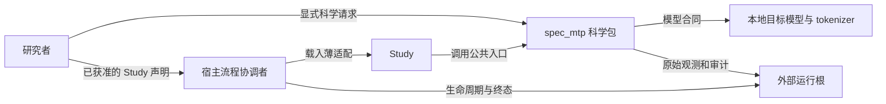
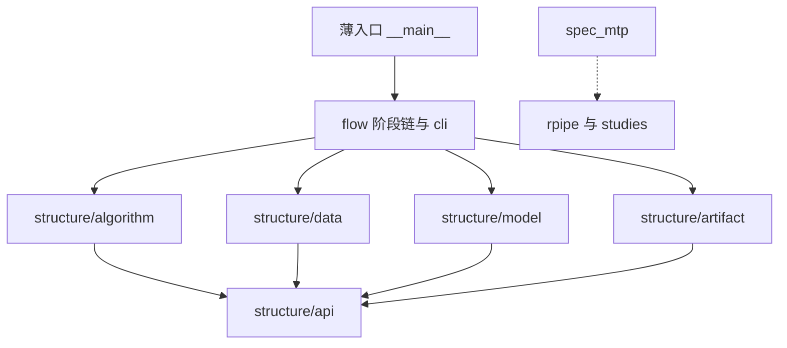
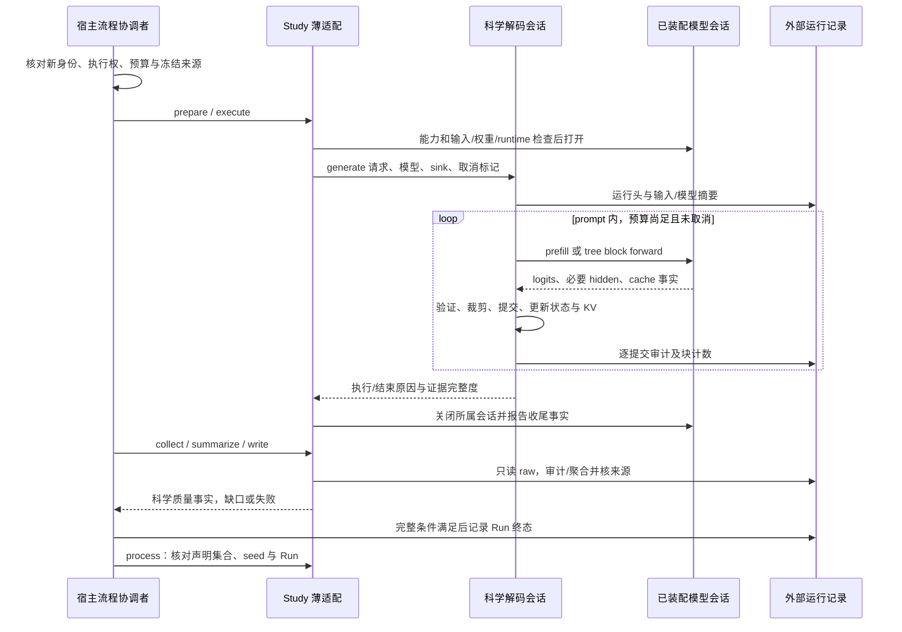
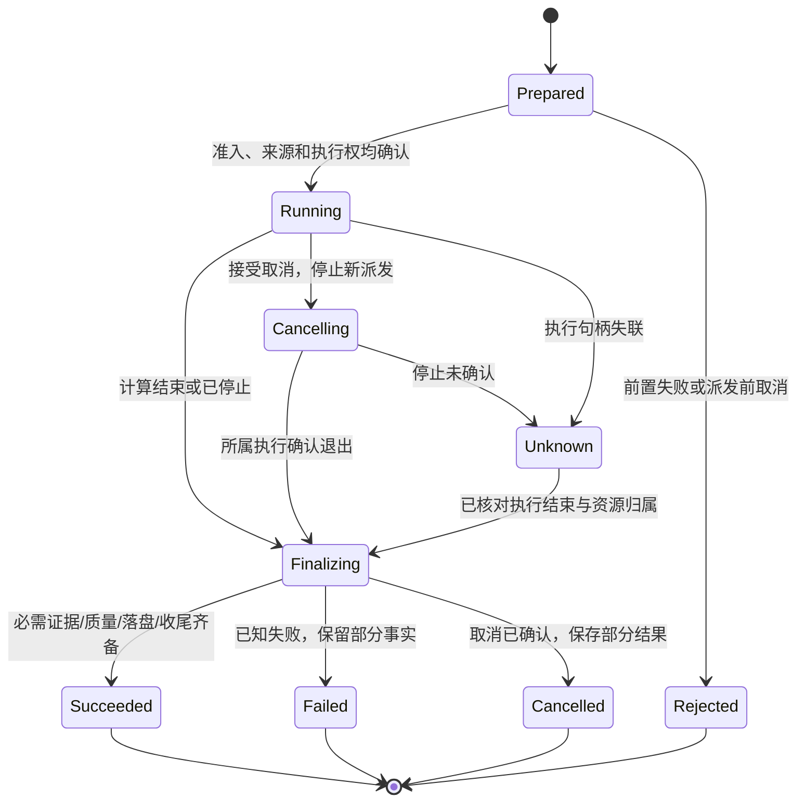

**去噪推测解码 架构设计**
更新日期：2026年11月6日。当前选定的职责与质量方向。源码映射见 [代码结构设计](<代码结构设计 Code Structure Design 去噪推测解码.md>)，实施差距与顺序见 [开发计划](<开发计划 Development Plan 去噪推测解码.md>)，科学主张见 [研究计划](<研究计划 Research Plan 去噪推测解码.md>)。机制由 [通用调研](<通用调研 General Research 去噪推测解码.md>) 解释，历史执行由 [运行记录](<运行记录 Run Record/INDEX.md>) 定位。

# 一、从研究目标推导架构
## （一）目标、上下文与约束
研究系统将冻结输入、模型与解码条件变成候选、验证提交、原始审计和可解释对照。首要目标是研究结论可靠：能定位每个提交来自哪个验证前向，来源变化会被拒绝，负结果和中断不会被改写成成功。其次是用相同科学入口比较 mask、树和预算，避免每个 Study 复制解码器。

这是目标上下文/交互图，箭头表示使用或数据写入，不表示 import。科学包独立于执行框架，Study 适配向阶段链提交科学事实，执行终态由阶段协调者决定。源码目录、逻辑模块和进程分别描述。`spec_mtp` 与每个 Study 的目录都是 `structure/` 加 `flow/`：前者组成一次 Run，后者跑阶段链。顶层只留薄入口。这条目录规则以代码结构设计为准；要改它，先改那份文档。源码归属由代码结构设计维护。

架构支持保存结果读取、来源追溯及已授权的工程验证。已收束的Kalman/EMA研究结论由唯一研究计划维护，不因结构维护重开；当前工程入口与计划分开说明，不把目标能力或旧计划当运行授权。固定ESP来源树、数据和旧Run保留。实际数值与模型验证用CUDA并记录设备，CPU运行安全合同；不另开算法方向、下载或自动恢复旧矩阵。
## （二）具体质量场景
| **编号与目标** | **触发、期望响应** | **边界与验收信号** |
| --- | --- | --- |
| Q1 科学正确性 | 变更 mask/树，提交链仍可对应验证行 | 同次 T0 argmax 全覆盖，拒绝 draft 不更新长期状态，KV 仅保留接受路径 |
| Q2 来源可追溯 | 输入、权重、源码或配置在 make 后变化 | 加载/执行前拒绝可检出的漂移，定稿再查实际来源；零解码调用或明确标出执行后漂移，旧原件不覆盖 |
| Q3 结果真实 | execute 完成但审计缺行、写满或聚合失败 | 执行完成、证据完整、数学门、论文差距分别呈现，Run 不伪成功，旧摘要不覆盖 |
| Q4 可修改与复用 | 换 mask 或模型接入，Study 因素不同 | mask 变更限科学模块与测试，Study 不复制 decoder，宿主不导入 RPipe/Study |
| Q5 可取消与恢复解释 | 阶段间取消、forward 中超时或进程失联 | 停新派发，保留执行句柄和已提交事实，确认退出才结束占用；未知不盲目重试 |
| Q6 资源有界 | 多任务争同一 GPU 或输入越预算 | 一个获准队列串行，先查资源和有限配置，拒绝后不加载模型；耗尽时保留部分结果 |
| Q7 离线可读 | 只看历史结果/比较，不重新执行模型 | JSON/标量读取无需 GPU，保存张量数值核验按当前设备合同使用 CUDA；始终零模型 forward/下载/launch，不以当前默认值替换旧记录口径 |

延迟、显存和超时阈值在具体设备/计划实测后确定，当前不编造性能门槛。自检、AR 等价、采样分布和速度收益的差别沿用通用调研。

原运行件、后补归档附注和当前派生工具分别保留身份。归档新增内容不自动成为原运行字段，不改原字节摘要或 source_binding；允许的附注范围由明确读件合同限定，共有科学字段不符仍失败。主机侧调用分析与 CUDA kernel/端到端吞吐是不同测量，报告必须标出实际计时范围。
## （三）规模与组织选择
首选单机模块化科学包，加同进程 Study 薄适配；宿主 flow 负责受控执行过程。数据、模型接入、解码、审计、分析是需要独立验证的责任，不按“层数齐全”增加服务、注册中心、事件总线或存储平台。

模型通常在一个受管子进程中使用 GPU。CLI、Study 和科学模块数量不决定进程数量。尚无跨设备服务或多模型调度需求，不建设微服务与通用插件框架。

# 二、构建块、合同和状态归属
## （一）黑盒责任
| **责任** | **提供与需要的合同** | **权威状态与隐藏细节** |
| --- | --- | --- |
| 输入 `data` | `read_prompts`、`encode_prompts`，显式 tokenizer 与输入条件 | 有效 qid/顺序/token/EOS 及数据摘要；不决定实验因素或执行排程 |
| 模型接入 `model` | 打开/关闭会话、能力、prefill/block forward、embedding 与所需 hidden | 拥有具体 HF 模型/tokenizer/device 与原生 cache 资源，不宣布研究成功 |
| 解码 `decode`、`masks`、`tree` | `generate`，借用模型会话、mask 策略、审计 sink、取消标记 | 一条 prompt 会话独占 committed 前缀、KV 逻辑长度、RNG、mask 长期状态与块内 proxy |
| 科学审计 `audit` | `audit_run`，原始提交观测、来源声明与实际摘要 → 分维度 verdict | 定义提交覆盖、owner/row、计数和来源一致性规则；不改 Run 终态，不补造缺失 raw |
| 分析 `analysis` | `summarize`、`compare`，已准入科学记录 → 指标与逐 prompt 对照 | 无活动执行状态，固定统计口径和缺口，不读取日志推断成功，不发起模型 |
| 宿主与 Study 的 `structure` / `flow` | structure 放契约、数据、模型、算法、系统、产物和注册；flow 把阶段跑起来并转调这些入口 | 宿主不导入 `rpipe` / `studies`；flow 可以导入 structure；structure 不导入 flow。源码映射见代码结构设计 |
| 宿主流程协调者 | 计划、执行权、六阶段、取消、记录终态与读取 | 唯一拥有 Run 生命周期、进程句柄、运行目录和整体执行结果，文档目标不表示当前 pin 已实现全部语义 |

共享数据和模型最小接口的目标位置是 `structure/api`。一次 decode 会话拥有科学可变状态，模型具体 cache 句柄由其接入管理，解码器决定只保留哪些语义位置。`audit` 返回质量事实，Study 的 flow 映射到阶段结果，双方不各维护最终 success。文件对照见代码结构设计。
## （二）公共数据与入口
| **合同** | **输入 → 输出** | **前置、后置与副作用** |
| --- | --- | --- |
| `generate(request, model_session, mask_policy, sink, cancel)` | `DecodeRequest` → `DecodeResult` | 有效单条 token 输入/配置、能力与新输出身份；按序前向并写观测，退出保留已提交 token，收尾不伪装完成 |
| `audit_run(raw, expected_sources)` | 原始观测和显式来源声明 → `AuditResult` | 仅读，拒绝版本/范围/哈希不符，缺 token/owner/行即不完整，失败原因分项返回 |
| `summarize(records, protocol)` | 完整/部分记录和原统计口径 → `Summary` | 纯计算，缺失项显示，不擅自排除不利 prompt，不将短输出 calls 当等长加速 |
| `compare(left, right, pairing)` | 同因素要求下的记录 → 配对结果 | 先核 qid/输入/协议/输出长度差异，再计算胜平负；不可比时给原因 |
| `ModelSession` | 能力、forward 请求与 cache 操作 → logits/必要 hidden/实际资源事实 | 打开才加载，明确 device/dtype/backend/context/tied-storage，close 只关闭本会话资源 |
| `ObservationSink` | 运行头、逐 prompt/块/提交记录和结束事实 | 写入者确认落盘结果，失败报告给调用者；不提供自动 launch 或补跑 |

`DecodeRequest` 包含实际 prompt IDs、EOS/最大长度、树/槽/方法配置、随机条件和来源标识。`DecodeResult` 分开 execution、termination_reason、committed、计数、raw 位置与 evidence_complete。`AuditResult` 分开 source_integrity、argmax_coverage、argmax_correctness、AR_diagnostic，不将论文目标比较塞入同一个 bool。

`ModelSession` 是进程内替换/假调用边界，不是网络协议。真实实现可以保留现有 HF 机制，假实现提供可控 logits 和 cache 观察。能力缺失即拒绝，不自动切换精度、后端、模型或云端。

`mask_policy` 由装配或 Study 为每条 prompt 创建，提供初始化、块内预测和提交后更新，声明是否需要 normalized hidden。decoder 只使用其行为合同，不按 Study 名加载类。输入/输出 provider 保留不同的实际观测需求，不强制制造无用 hidden。K 当前 postcommit CPU pilot 只提取同位置表示对与回归，不经过真实 speculative slot，也不以该策略接口暗示已具备起草应用。
## （三）科学不变量
- 每条生成有独立 committed 状态与 RNG，prompt 切换后不残留上一条 mask/KV。prefill 产生首 token，不能被漏审
- 仅实际提交 token 更新 input mask 长期历史；输出长期状态仅使用已提交位置的真实 normalized hidden。预测 proxy 和块内模拟只活在当前块
- 树节点有稳定 parent/depth/position/owner 映射。验证接受路径、bonus 与 mask-logits seed 在同一映射下解释，错误 owner 即失败
- EOS/预算裁剪后 committed 与 raw 审计一致，accepted、committed、prefill、decode_calls、total_calls 各自计数，不补默认0掩盖缺字段
- 保留 KV 的路径和 `cache_len/root_pos` 对应，不能把被拒节点或未提交 bonus 当缓存。模型接入检查实际 context 容量
- T0 每个提交 token 都关联其真实验证 forward 的 argmax，审计不能事后用新 forward 补证旧行。非 T0 不冒用 T0 正确性合同
- 独立 AR 可分叉，诊断保留首差异/长度；不能因差异自动重跑，也不能删除负例改写统计母数

普通父包导入不构建运行对象或加载模型依赖，装配由明确生命周期入口调用实际部件。配置文件属于持久化边界：保留合法空文档及mapping内的false/0，拒绝顶层非mapping；非法新写入在原子替换前停止，旧配置不改。预设返回值与单次覆盖各自独立，不把一次配置选择传播到下一次默认值。

测试结果的执行完成、测量有效与质量判定分别呈现。测量声明固定指标名称、单位和统计口径，采集保存原始样本、规模及环境；空或无效测量不进入成功终态。setup/call/teardown全部完成且证据落盘后，纯numeric只发布measured与null质量判定，分类断言按原合同判定。逐阶段原生结果与最终正式结果区分，写失败或阶段缺失阻断整批，不用设备说明充作实测值。

批次报告只消费本次已保存的声明、环境、收集与逐参数证据，不用当前默认或旧候选补造范围。正式summary最后绑定报告与证据摘要；报告写失败、读写中漂移或终态与候选身份不一致时不发布成功。无selection时参数总数保持未知，未执行/跳过/测量完成与质量通过分列，实际成本的计量边界与未知资源单独解释。报告正文保必要错误类别与证据定位，原始异常载荷留诊断材料。

# 三、源码依赖与运行时调用
## （一）目标 import 方向

箭头仅表示目标 import。`flow` 可以导入 `structure`。`structure` 不导入 `flow`。`api` 不导入其他 structure 子层。解码通过注入模型会话进入具体接入，源码不导入 HF 接入。`spec_mtp` 不导入 `rpipe` 或 `studies`。数据与模型不导入解码，审计与分析不导入模型。跨研究复用进入宿主公共入口，Study 内部私有函数不被宿主反向导入。

依赖方向由静态检查和具体调用测试共同约束。旧流程 API facade 已删除，直接反向依赖清单为空；父包间接装配链和其余实现差距见开发计划。静态检查不证明动态导入、状态和数值合同正确。
## （二）一次完整研究运行

这是满足前提的目标运行路径。来源预检、资源准入、输入校验失败都应是零模型调用。运行后来源漂移、sink 写失败与 close 失败分别保留，不抹已发生的 forward 或已提交 token。process 只核对实际声明集合，不从成功子集推完整矩阵。

# 四、执行、取消、恢复与部署
## （一）分开 Run 与 prompt 状态
Run 生命周期权威在本仓 FlowRunner，科学 decode 只报告本条计算的进展与结束事实。下图是期望协调语义，实际强取消与外部运行根能力须按对应实现和运行证据验收。

取消不是回滚。forward 中无法立刻停止时，保留忙状态和所属句柄，等待当前调用返回再拒绝下一块；需要硬终止仅由拥有 worker 的协调者执行，不能结束其它项目进程。未知运行不得继续占用同一输出身份或设备执行权。

恢复先依据持久化记录识别完整/部分/未知，核对原始文件与进程状态。研究当前没有任意 KV/mask/RNG checkpoint 恢复保证，不能把 RPipe 阶段恢复当 token 中途续算。确需重试时用新的运行身份并明确从何处重算，保留旧失败；旧成功 Run 不 make/remake 重签。
## （二）部署与资源
| **运行单元** | **职责与边界** |
| --- | --- |
| 研究者 CLI/本地协调进程 | 读计划、核范围、调本仓 FlowRunner 或科学入口，读端无执行权。普通 import/help 不加载模型 |
| 一个受管执行 worker | 加载模型及 tokenizer，逐条 decode，同进程科学模块与 Study 适配，拥有其 CUDA/cache/文件句柄 |
| 单台主机/GPU | 已获准队列串行，资源准入以实际 CUDA、显存、host 峰值加2GiB等已确认条件为准，不抢占别的任务 |
| 源码 checkout | Python 包、固定副本、研究声明、原始静态数据与四文档，保持可审阅和可打包 |
| 显式外部运行根 | 独立运行身份下的冻结快照、raw、来源/审计/汇总、诊断日志和终态，不回写源码 Study docs |

研究运行根与源码、模型和原始输入分离是目标合同。当前默认相对布局在显式外部Study根下组织 `runs/shared`，源码Study写入被拒绝。实施时须验证路径、锁、续算、CLI 与证据读取，沿用单一阶段协调者。

# 五、证据、输入与故障合同
## （一）输入信任边界
CLI、YAML/JSON、token 数据、Hub 文件和旧运行记录都校验形状、版本、大小/数量、有限数值、允许范围、路径归属与来源。布尔不作数值，NaN/Infinity 不进指标，qid/序号重复或混 Run 必须报错。能力、格式或输入缺失不得静默回退到另模型/精度/默认 prompt。

模型 cache 的原生数据不作为公共结果传给读端。外部提供的路径限制到明确输入/运行根，路径含中文/空格可正常使用。tokenizer、chat template、thinking、EOS、context 与停止条件都是输入合同的一部分。模型名相同不代替实际内容 digest，未知 immutable revision 不伪填当前 HEAD。
## （二）业务证据与日志
冻结运行头记录 schema、执行提交/差异、宿主流程协调者、Study/配置/计划 commit/blob、输入/模型/runtime/随机条件、预期矩阵和 raw 位置。逐 prompt/块/提交观测保存 forward/row/owner、token、验证 argmax、accepted/committed、cache/停止与实际计数。必要 evidence 写失败立即停止下一前向，保留已执行事实。

原始结果、摘要与终态之间没有跨文件事务保证。先写临时文件、校验后原子替换适用于单文件保全，不保证整套运行原子提交。缺结束记录或 raw 截断即未确认，不能因行数看似齐全推正常完成。重算另存分析版本与输入哈希，不能覆盖旧结论。

诊断日志由统一 Logger 保存为 UTF-8 JSONL，包含 timestamp/level/event/logger/message/app_name/app_version/runtime_id/process_name/pid，按场景加 Run/phase、outcome 和实际耗时。未知可选项省略，凭据、prompt 正文和完整 tensor 不进普通日志。sink 故障记录实际影响，日志无错误不能作为成功依据。

诊断按完整记录保全分段，稳定锚点与旧段不覆盖、不删除；状态与logs读取全段，报告链接末段。单段4MiB、单条65536字符含LF，解析路径别名/硬链、缺段和截断拒绝；同进程多实例写入协调不扩大为跨进程协议。严格直接API的追加IO错误仍上抛并保留可能的partial事实，宿主托管隔离按下述独立合同；新空托管日志另按policy限制累计容量和追加期限；物理保留期与跨Run总量仍待收束，不能由日志读取成功推断这些能力。指标Tracker与checkpoint恢复字节偏移保持独立。

宿主诊断采用显式托管模式，与严格直接Logger API分开。诊断构造、格式化、序列化、文件与console故障不会改业务结果或替换首个业务异常；KeyboardInterrupt/SystemExit继续传播。Flow向System注入同一Run Logger，避免实例状态分叉。记录failure_count只代表失败诊断操作，不能断言对应记录未落盘；stderr二次故障也不能妨碍业务。算法执行、Tracker状态落盘、checkpoint发布及正式Result仍按其原合同失败，不能由托管模式降级成成功。14个Study独立创建点已显式采用同一managed模式，构造绑定、配对报告和CUDA smoke分别有实际故障验收，完整14协议未逐一运行。五个保存件绘图flow把owned Figure释放成功作为新completion发布前置，随后构造receipt并最终核对输入/来源；主体失败保原异常并附清理次错。失败新marker由既有独占publisher收尾，旧文件保全。office/fair/fresh/preforward四个模型flow已将本函数首错、取消及关闭次错分开，owned模型关闭一次后再最终复核；正常关闭失败必须上抛，不能因调用者处于异常处理上下文而被误当作次错。office/fair/preforward最后发布完成件，fresh保留原summary数据并在关闭及复核后返回。pilot两个producer从训练返回session后也保护所有权，正常结束或取消/失败均关闭一次，并保留本函数原异常与清理次错。训练工厂在session构造后保护实际tied-storage准入，拒绝、属性错误或取消时关闭一次并保首错，成功返回不关闭；borrowed native保持，不能据close推定借用显存释放。正常模型固定请求tied，受控反例不证明自然untied生产路径存在；日志隔离不代替资源释放成功。HFCausalLM取得hf后的四句初始化由构造器承担失败所有权：异常或取消关闭半成品session一次，保首错并附close次错；owned只断开自身hf引用，borrowed保持native，正常交付不关闭。pilot把唯一eval委托该构造器，不重复调用。loader取得对象前或原生训练失败、外部traceback引用及CUDA缓存的寿命另属边界，不能从close推定即时显存回收。固定依赖的模型加载接口一次调用dtype，不对内部TypeError重试或换参掩盖首错。科学CLI及共享diagnostics在close收到取消时仍尝试其余已取得资源，按原正序/逆序保首错与有序次错；这不等于每次被中断的OS close已完成，也不清理外部traceback或保证即时显存释放。启动验收保留原90秒launch门；独立进程的字节码缓存置于显式外部任务根，冷缓存编译与真实执行耗时分别取证，不用延后计时或放宽门限隐藏启动成本。

采集policy由新空诊断根独占冻结，当前默认每Run64MiB（policy与全部JSONL合计）和实际UTC起点后7天；重开不延期、旧非空无policy不补签。准入写前核下一条完整记录，已到期限/配额或无可信旧绑定时只停止诊断追加，正式业务继续；主动抑制与未知诊断故障分别计数，计数仅限本Logger实例。原日志与业务证据不清理；物理保留期、跨Run全盘限额和同步文件IO等待上界不在该合同中。

P1只读诊断inventory已实现：运行查看端按index绑定每个Run的规范日志家族，复用写端policy校验，报告实际总字节、受采集配额约束的字节和冻结追加期限。未知起点/配额保持未知，追加窗口到期不推定任务停止或对象可删，所有行retain；重复Run标识或规范目录在库存准入拒绝，不以重复行充当独立占用；前后家族/文件身份与尺寸变化、不可信路径及列举/metadata失败拒绝，不把IO失败当零。CLI在构造完整结果后输出JSON，准入/读取/构造失败仅给安全类别和非零退出，不输出半份清单；stdout故障原子性未承诺。默认日志阅读保持原行为，入口不建来源锁或Run，不读取业务证据/诊断正文或改写原件；全盘配额、物理清理与阻塞IO超时仍未支持，实施证据从日期记录定位。

CSV指标行与诊断日志分开。可选文件Logger按首个有效header固定列序，每次追加前核现有header和末尾记录边界；同键重排不改变字段含义，schema不符、header损坏或目标状态变化必须拒绝，旧行不修补。stdout-only仍可输出动态指标，四位小数与step/prefix格式保持。追加IO失败上抛，CSV不是原子事务、并发写协议或科学完成标记；native正式指标资产由collect和后续gate另行校验。

配对报告写端拥有本次Figure及派生文件。主体失败后释放Figure，清理次错随原异常保留，不能遮盖首错；正常释放成功后才构造receipt、复核输入与源码并发布完成标记。receipt构造或释放期间漂移、清理失败均不能产生成功终态，已写partial事实保留。共享publisher接口不因整理变化，保存计数/Agg渲染不是CUDA或性能测量；新源码摘要与历史原件身份分别记录。
## （三）失败处理
| **故障** | **处理与继续条件** |
| --- | --- |
| 输入、冻结来源或资源前置拒绝 | 零 forward，不生成成功结果，不自动改因素/精度/数据规模绕过 |
| 模型加载或前向失败 | 保留阶段、异常与已执行部分，关闭所属资源。OOM 不自动重试同身份 |
| 原始证据写满/截断 | 停下一块，返回证据不完整，已发生 token 不伪称未执行 |
| 数学门或来源复核失败 | 保留 raw、失败原因和旧摘要，不进入成功定稿与依赖实验 |
| 独立 AR 失配 | 记录首分叉和长度，仅诊断，不当成重试触发器 |
| 终态写失败或 worker 失联 | 结果待核对，禁止同身份重放，先恢复事实与资源归属 |
| 读端损坏/版本未知 | 明确不可比较或不完整，零模型/排程调用，不按新默认悄悄修数据 |

# 六、Study、科学包与固定副本
宿主和每个 Study 都按 `structure/`、`flow/` 组织。`study.yaml` 说明因素、seed、扩展及冻结声明，`experiment_config.yaml` 提供基础配置。`structure/` 放该研究确需的组成与纯计算，`flow/` 只覆盖实际特有阶段，并包含命令实现。顶层不放独立脚本。prepare/execute/collect/summarize/write/process 六阶段继续复用，缺职责不创建空文件或复制全库。`trajectory_observation` 的声明和 `flow/` 尚未补齐，现有脚本保持原样并列入 legacy 清单。

研究问题和实验安排只在唯一中文研究计划按 Study 分章，实际结果从运行记录定位，执行 raw 和可重建报告在外部运行根。Study、测试和工具不再规划 README、PLAN、NUMBERS 或逐事报告。测试排除项和入口说明留本文与代码结构设计。

共同合同对齐2026年10月21日 RPipe 文档重设计固定提交 `057666b432661694575d91150c232e63254e96bd` 的 [研究流水线 架构设计](https://github.com/DreamSoul-AI/RPipe/blob/057666b432661694575d91150c232e63254e96bd/docs/研究流水线%20架构设计.md) 第五章。其目标语义不是 SD 当前固定副本能力，后续采用仍需实现与评审。2026年11月1日起本仓不再内嵌该副本，Study 流程由 `spec_mtp` 实现，并以上游仓库为结构模板持续对齐。

科学 CLI 提供 decode/audit/compare，Study 从共享 flow 入口进入宿主阶段链。旧科学入口的 make/launch/process 明确拒绝并提示 Study 入口。包初始化不加载模型或阶段链。

已选的 `k_affine_residual` 在 Study `structure/` 实现协议 `postcommit-final-norm-v1`：m 为已提交前缀的连续均值 embedding，y 为刚提交 token，同一因果位置比较最终归一化 hidden。拟合为 float64 中心化 ridge λ=.001，截距不正则；仅 bias 使用独立 b0。先冻结 K 再读 holdout/cross。当前 Study 配置是合成 token 的工程夹具，不是 160 对数据协议，也不是 2026年10月31日会议中的 trajectory 与 observation 联合更新。代码拒绝把 Kalman 或 trajectory/observation 名称当成已实现协议。latent MSE 不能写成接受率提升。公式与对照见研究计划。

# 七、验证、测试与 CI/CD
## （一）合同到用例
测试镜像目标 Python 结构，unit/integration/e2e 是标签。每项一个主要信号，逐参数独立标识，不用一个“全树正确”大断言锁死临时结构。

| **目标与路径** | **最小输入/故障** | **必需信号** |
| --- | --- | --- |
| data → 科学请求 | 中文、空 prompt、重复 qid、EOS/模板漂移、越 context | 明确拒绝/来源，零模型调用，不换输入 |
| model 合同 | 假 logits/hidden、无 tied、后端/精度不符、close 失败 | 能力检查、资源所有权与原始失败保留 |
| decode → mask/tree/model | 微型可枚举模型、错 parent、bonus/EOS、拒绝路径 | 完整 token/owner/row、KV 不变量和状态只随提交更新 |
| masks | 零范数、非有限、首差分、冻结更新、proxy 模拟 | committed 不被污染，初始化/β/γ/slot 语义与既定合同一致 |
| audit → raw | 缺首 token/行/owner、哈希漂移、重复/混 Run、坏记录 | 拒绝不完整与损坏，AR 差异只诊断，零 forward |
| analysis → 配对 | pooled/均值不同、缺 prompt、长度不同、负例 | 固定母数/口径，保留胜平负与不可比项，不擅作速度结论 |
| Study/FlowRunner 集成 | 来源拒绝、单 Run 故障、取消、process 子集 | 宿主入口被调用一次，唯一协调权、首错与终态保存，旧成功字节不变 |
| 用户科学 CLI 旅程 | 显式 decode/audit/compare、无参数/help | help 零载模，假模型贯通到可见结果；审计和比较零启动 |

纯JSON、配置、保存标量、IO与既有CPU小规模合同为CPU门；CUDA数值/模型合同在真实GPU验证并记录设备，不因无卡回退。真实tiny BF16、目标4B/8B、CUDA/cache/ABI、包安装和资源行为分别验证，假调用不能代替真实模型证据。第三方原树只核来源字节及明确适配合同，不纳入本仓任意格式化或未来源文件镜像改造。
## （二）计划、元数据与结果
保留pytest，现有执行适配复用其选择、阶段和逐参数结果机制。静态配置声明test_id、level/type/cost_class/result_type/priority、目标/tags和result_detail，逐参数/attempt独立。测试说明与排除跟随实际合同及唯一清单，不新增tests/README。

快速计划选受影响 P1/P2、C1 的离线数据/状态/审计项，回归计划扩至相关 C2 和假模型集成。GPU测试按实际规模与资源消耗定成本，微型工程夹具与大矩阵分别安排，须明确设备、单项/整批时间与内存/显存预算、配置数量、重复、并发及停止规则。当前没有实测预算不编数字；旧 GPU 计划暂停，不借测试名恢复研究。

结果逐项落盘到独立验证根，含 run_id、plan_id、test_id、attempt、五维、环境/源提交/基线、status、verdict、metrics、cost、duration、failure 和 artifacts，保留 setup/call/teardown。纯测量 `measured/verdict=null`，有质量门才 passed/failed，error/timeout/missing 和不允许的 skipped 阻断。中断可从已存记录重建部分报告，不用“已执行子集通过”替代完成。
## （三）当前未完成项与发布边界
快速单元覆盖离线IO与状态边界，CUDA计划覆盖tiny解码、保存张量及外部根Study六阶段；原cpu-pr保留既有范围。历史原件重放与真实模型实验分开登记。本轮不改 Actions、保护规则或依赖版本。测试通过只说明工程合同，不说明论文目标或速度收益。未执行项见开发计划和运行记录。

当前 Actions 的 `cpu-checks` 在 PR 及其既定分支运行 Ubuntu/Python3.12，Branch flow 检查工作分支 → dev → main。本轮不改工作流、保护、pin 或自动合并。未来按受影响合同、本地假路径、包安装和必要 GPU 条件分阶段验证，结果绑定实际提交、目标基线、环境及交付文件哈希。源码测试与构建完成不代表已发布。

# 八、必要性、代价与实施顺序
| **决定** | **解决场景与不增加的后果** | **成本与升级条件** |
| --- | --- | --- |
| 标准科学包独立于 RPipe | Q4，避免每个 Study 复制/改同一算法 | 公共合同与一层薄适配成本；跨研究有真实共用时进入宿主，不建通用注册平台 |
| 一个 decode 会话拥有科学状态 | Q1/Q5，分散 KV/mask/RNG 容易错位和串样本 | 会话生命周期测试；只有明确并发需求才增多会话调度 |
| 模型最小合同 | Q1/Q4，真实加载与假验证需分离 | 少量数据与能力映射；新增后端语义不等价就修改合同，不静默转换 |
| 审计和分析分开 | Q3/Q7，计数完成不能代替原始正确性 | 维护两组纯规则，避免读端加载模型；无需独立数据库或服务 |
| 独立运行根与单协调者 | Q2/Q5，源目录写运行物与双启动破坏身份 | 本仓外部Study根已承接路径与来源合同，强取消仍需独立验证，保留单一FlowRunner |
| 正文少量视图与依赖草案 | Q4，能评审源码/行为/部署而不混箭头 | Mermaid 与人工合同复核，出现持续边界维护成本后再接工具，不全套 UML/C4/arc42/OCL |

实施候选顺序为：先冻结科学合同与可枚举 CPU 反例，再迁移纯 mask/tree/analysis，随后迁移 model/decode/audit 与测试镜像，最后改 Study/CLI/来源与运行根接入。每步核对实际 token/计数/错误行为，不能把目录移动本身当行为等价。旧消费者、静态配置及测试需随实际改造完整更新，删除其它源码或数据仍先核用户范围。

质量场景、黑盒职责、源码/运行/部署分离和简约取舍是本项目的裁剪。RPipe 作为结构参考，宿主流程由本仓实现。本文描述当前选定职责；源码映射以代码结构设计为准，完成状态以运行记录为准。

## （四）本分支的设备验证边界
`tests/manifest.json` 是静态用例清单，`tests/run.py` 仅适配 pytest 选择和逐项记录，不参与 GitHub 工作流。CPU 计划包括科学宿主、实际 Study 接入、损坏/缺失/配对/来源拒绝及 K 合成工程合同。历史重放从固定 Git blob 提取不可变输入，当前读端执行验收。缺对象直接失败，保存观测与模型重跑分别解释。

K 工程 fixture 使用随机 tied tiny LLaMA、CPU FP32、eager；先拟合并独占写入 full K/b0，再提取 holdout/cross。collect 核文件 SHA、fit IDs/hash、模型空间和配对，summarize/process 拒绝缺三臂/缺 split/缺 seed。它只验证工程路径，原计划160对协议及真实接受收益未执行。完整外部运行根已由本仓布局与入口实现，强取消差距仍需独立验收；现有K夹具的CPU行为不冒充本轮CUDA验证。

显式外部 Study 运行根承接新运行的声明快照、Run、共享制品和日志；源码 Study 作为只读输入。首次建立先核全部输入与目录分离，执行前复核原 Study 和快照，任何缺失或漂移均阻断，不把新根当旧 Run 的迁移或重签。CUDA 工程验证先确认设备可用并保存设备身份，CPU仅承担快速单元检查；设备忙时等待或缩小规模，研究路线仍由研究计划与 Enmao 确认。

共享执行适配由各 Study 的原来源门之后显式装配，导入不占用注册表或改执行环境。配对、普通方向和 recovery 分别绑定其实际输入根与准入策略；等待事件记录归当前 Run 资产，不能落源码根或扩大为训练状态恢复。方向随机序列和控制公式是原协议的一部分，设备迁移或代码合并不得改换序列。

同一 decoder 跨 prompt 复用时，控制对象读取当前 prompt 的起点，诊断写入稳定容器并逐行保存独立快照，后续 prompt 不得清空或改写已有行。来源与原源绑定在注册、载模前及执行收尾复核；资源等待返回后须再次校验，等待成功不能掩盖期间的输入漂移。

保存证据读端区分四种身份：固定 Git 原件、实际运行输入、原生产工具与当前读端。计数复核只能确认已有输入在原协议下的聚合，不重新授予 native 质量门；原工具字节缺失保持未知。张量数值审计显式使用 CUDA，来源与输入在计算前冻结并在发布前再核，完成记录最后发布。中文报告只链接实际已核输入，未提供的历史引用以文字说明，不猜测新根下存在旧 docs，也不把历史建议当当前研究计划。

完整观测、分析完成与科学质量分别保存。full AR 的不一致记录不因相邻 argmax 协议通过而改判，也不因旧 result 失败就从读端排除；来源与输入完整时可生成质量为负的完整分析。协议门由所属 Study 保持，通用读件会话只统一路径、身份和发布生命周期。

归档报告、原工具和原计划各自绑定完整提交、成员与摘要，不能要求它们恰好共存于一次归档提交。成员路径依原角色明确准入，不按当前目录替换旧路径；源码只读核字节，不执行归档程序。完整保存张量审计与新模型/采样实验分开，原生输出合同、假设判读和工程夹具也分别报告。

独立进程调度先验证外部根、来源与当前计划，再派发shared CLI worker；worker再次预检，实际PID和CUDA设备随运行证据保存。调度保存的jobs必须绑定index及规范config路径，空队列仍以聚合complete判断成功。派发异常只清理本次已取得的进程句柄并保留首错；默认不自动重试。pending调度恢复与checkpoint/RNG恢复分别验收。

# 九、Checkpoint 与 RNG 恢复合同
调度恢复仅处理哪些Run已完成或待派发。checkpoint恢复还要恢复科学状态；以下CR标识单独约束恢复验收，不由调度通过、同seed或文件能载入推出完整等价。

| **合同** | **准入、状态与验收** | **当前边界** |
| --- | --- | --- |
| CR0 身份与准入 | 绑定checkpoint原字节SHA、来源/配置/模型、步数预算、实际device/dtype/backend与CUDA映射。所有身份、schema、状态和Data能力先校验，再修改活跃model/optimizer/tracker/RNG；旧Run不重签，恢复尝试另记原checkpoint | native训练已分读取、纯准入、应用；拒绝合同、模型keys/shape/dtype、计数、Data/RNG及已声明状态结构不符。模型/数据身份仍基于声明元数据，不替代来源代码或数据内容冻结；自定义optimizer语义不在当前完整保证内 |
| CR1 持久化 | 使用已授权可信的本地checkpoint。完整bundle为提交边界，piece mirror或incomplete标记不独立证明完整；载入不改变原件，缺失/截断/身份漂移拒绝 | 独占同目录stage完整写入并flush/fsync，最后替换bundle。提交前故障保全旧bundle；提交后诊断清理不翻转成功。旧分片无bundle时须显式迁移，拒绝隐式覆盖；未发布stage及解析别名不能作为恢复源。路径解析只读，载入前后核SHA；未声称断电或并发写保证 |
| CR2 RNG | Python、NumPy、Torch CPU及已冻结的全部CUDA全局状态先在独立生成器试装，再提交；缺域/损坏/设备数量不等或不可用时，全局状态不变。显式generator必须独立保存恢复 | CUDA逐域往返与四类损坏拒绝已验证。cuda=None只表示未冻结该域，恢复时不查询或初始化CUDA，不称GPU轨迹恢复；不保证硬件运行中故障的跨库事务回滚 |
| CR3 模型与优化 | 固定架构、dtype、optimizer/scheduler及计数，恢复后的下一批输入、loss、参数、动量、LR应匹配连续执行；bitwise与容差判据按后端声明 | 同进程受控单步与native新进程微型CUDA的SGD momentum/StepLR结果精确匹配；不外推真实模型、跨设备、HF Trainer或长训练 |
| CR4 数据与指标 | 保存sampler/loader的显式CPU generator、共享关系、batch cursor、数据身份、epoch/step和tracker。支持零worker、标准DataLoader/BatchSampler及SequentialSampler或有generator的RandomSampler；其它能力未知应拒绝exact恢复或明记partial | Data子状态v2先纯校验再挂起，进入iterator前复验；只重放sampler索引，不重跑已消费样本transform。独立、共享或无loader generator及末yield/StopIteration边界已有回归。旧Data v1未冻结共享关系，拒绝exact且不重签；未覆盖prefetch、多worker或分布式 |
| CR5 新进程对照 | 同一冻结条件连续k+m步，对照新进程载第k步checkpoint再执行m步。逐批核样本ID、全域RNG、参数与optimizer/scheduler/tracker/预算终态，记录实际PID、CUDA设备、版本与失败 | native微型CUDA覆盖6步预算及完整重绑、3epoch预算、5epoch预算下stall触发的早停；固定score只检验停止逻辑。终态恢复不新增batch、eval或科学写入，epoch与step双上限生效；原checkpoint摘要不变。只证明此固定环境与能力范围 |

恢复功能、工程回归与研究结论分别报告。无法证明某域完整时保留partial/未知范围，不清空旧证据、不换成功重复，也不把恢复差异归因于新算法。

## 微型探针与保存证据读端
native shared CLI 的旧 smoke 验证迁移遵循以下独立合同，不把旧 CPU 接受数作为 CUDA 基线。

| **合同** | **输入、设备与判据** |
| --- | --- |
| NS0 身份 | 原 CPU Study、Run 和 27/31/8 接受数保持历史身份。新验证复制声明到外部新根，使用独立 version；保存实际配置、源码、输入及模型摘要，不覆盖旧证据 |
| NS1 设备与随机性 | 数值用例先确认 CUDA 可用并记录实际设备；system 与 eval 绑定同一 CUDA 设备，微型模型在该设备初始化和前向。输入的 CPU generator 只准备固定离散 token，运行种子与初始化路径另记，不承诺跨设备 RNG 或权重逐位等价 |
| NS2 正确性 | T0 依据完整提交链 verification-forward argmax、token 数及输入/输出摘要。独立 AR 的一致率和接受数保留为诊断，不替代 argmax 门或复用旧 CPU 常数；alignment、AR-only 与 output-hidden 分别按其原任务合同验收 |
| NS3 生命周期 | 经真实 shared CLI 的 make/run/launch/collect/process/write 调用和原来源门，结果、输入与资产均绑定本次运行；来源漂移和不完整集合必须拒绝，旧成功文件不得被失败预检覆盖 |
| NS4 成本与覆盖 | 纯配置、来源拒绝和 IO 用例为快速 CPU 检查；真实微型模型路径标 CUDA/C3 并按计划预算选择。缺 CUDA、阶段、结果或设备证据不能记通过；局部随机 tiny 验证不代表旧研究矩阵、真实性能或完整历史重验 |

smoke当前CUDA微型探针与历史CPU图件有独立身份。探针在新版本和外部输出根冻结计划、模型、输入、协议、设备及随机条件；T0验证完整提交链argmax，采样AR只诊断。比较先要求probe/header/cells与最后完成标记逐SHA绑定，再要求同一冻结身份的完整报告，历史CPU报告不产生跨设备逐位保证。历史图只读原标量，不执行探针。

extension保存张量审计只复用已冻结的原件。读端先核每种审计的精确角色集合、原运行件与固定Git成员、原工具/计划/辅助模块，再在显式CUDA设备计算，收尾复核原件与当前源后最后发布完成标记。旧实时模型与profiler不属于该能力。当前CUDA概率与margin不回写旧CPU参考，来源缺口阻断相应读取。
