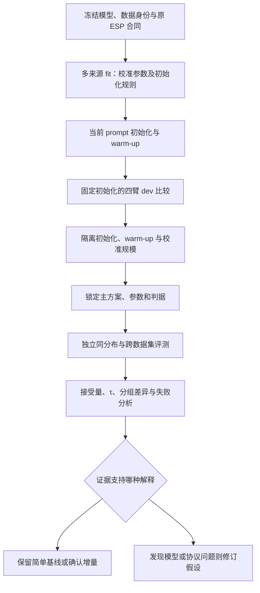

# 研究计划 Research Plan 去噪推测解码

更新日期：2026年11月27日。当前研究为 input 的 M-only 探测状态。沿用公共 ESP block 和验证，基础结构为 EMA／Holt，增益机制为固定／Kalman。本文是唯一当前研究计划，历史协议与运行结果从日期研究／运行记录定位，不在正文尾部继续重复旧版计划。

## 一、已有成果、问题与当前目标

### （一）已有证据及可比范围

| **已有证据** | **实际观察** | **对当前计划的约束** |
| --- | --- | --- |
| 4B input E1 | 零阶τ=1.4413，差分1.4486，Holt1.4444，动态Kalman1.4240，冻结增益1.4476 | 一阶稳定优势未建立，动态未胜冻结，不预设 Kalman 有效 |
| 8B固定参数 input 比较 | 零阶1.5030，差分1.5019，Holt1.4963，Kalman1.4710 | 当前零阶是强基线，不能按算法复杂度判优 |
| 4B增益轨迹分析 | 旧P0=I时早期趋势修正远强于稳态 | 初始化与瞬态是待检验解释，不是已证明原因 |
| Jason来源仿射校准 | 有特定开发／迁移条件下的接受收益方向 | 是不同目标的条件校准参照，不是本轮 Kalman 状态模型，也不直接混入主比较 |
| 当前理论梳理 | M-only 下独立差分 V 未被读出就不产生作用，Holt 则由旧 V 参与 M 更新 | 新四臂必须按共享 M 接口执行，不能直接复用旧 M+hV 数字冒充本轮结果 |

历史 E1 采用 Qwen3-4B、BF16/eager、thinking=false、单槽静态 branches=[14]、BC30、512输入／64生成、Dolly八类 dev8／eval32。旧方法调参条件数不同，只有一次小留出，区间为探索性。8B使用4B开发固定参数与另一次相同规模留出。来源分别见 [4B研究记录](<研究记录 Research Record/2026-11-21 输入状态首轮比较.md>)、[4B运行记录](<运行记录 Run Record/2026-11-21 输入状态E1实验.md>)、[8B研究记录](<研究记录 Research Record/2026-11-21 8B输入输出路线比较.md>) 和 [8B运行记录](<运行记录 Run Record/2026-11-21 8B输入输出状态比较.md>)。

旧实验存在显式距离外推、共享协方差、不同数值状态和读出等条件。新 M-only 四臂尚未执行，不能把旧表改名后当作完成。output 结果只作为历史证据，不在当前计划继续展开。

### （二）目标与机制问题

宏观目标是在同模型推测解码中提高每次模型调用的有效推进量，使方法改动能够由明确状态和受控比较解释。当前不以速度测试、几何拟合误差或理论复杂度作为贡献本身。

| **问题** | **待检验假设** | **什么结果不支持它** |
| --- | --- | --- |
| R1：趋势能否通过 M 更新改善探测 | M-only 下，Holt 比零阶有配对验收增量 | 增量不稳、仅某个初始化或单一类别有效 |
| R2：协方差增益是否有用 | 相同状态阶数、观测与预算下，Kalman 比固定权重有增量 | 相同调参资源下无增量，或只与早期强增益相关 |
| R3：初始化影响多大 | 数据驱动的 M0/V0/P0 或 warm-up 改善早期状态并保留验收收益 | 只有训练拟合改善，独立评测接受量不变或下降 |
| R4：大样本、多来源 calibration 是否有价值 | 参数与初始化规则更稳定，并能冻结迁移 | 最优值随抽样／数据集大幅漂移，留出无收益 |
| R5：状态与增益是否有交互 | Kalman 对 EMA 与 Holt 的作用不同且可重复 | 差异由不同初值、信息或搜索预算解释 |

前两项是主问题，初始化和校准解释它们在什么条件下成立。相同设置下比较四臂是完整系统方案比较，因滤波轨迹本来不同，不声称除了一个数值以外其余状态恒等。

## 二、算法与接口合同

### （一）固定的公共流程

当前仅改变附属探测槽的状态更新。正式树节点使用 hard token embedding，soft 槽统一写共享 M。原 ESP 的候选评分、树展开／剪枝、BC、每节点槽数、attention／position、贪心验收、缓存保留与结束裁剪在各臂之间一致。固定一种原有配置后先不研究树资源分配。

已正式提交的 token 给出 z=E(ID)。未验证 draft 只是提案，不提前写入正式状态。一次 verification 提交多枚 token 时，依位置顺序更新一次，修正／bonus 按相同提交口径纳入。更新不改变旧候选和已算 logits。未走过的分支不是实际路径标签。

输入槽位 p 的 logits 预测 token p+1。当前并不把这份 probe 输出当作额外滤波观测，避免将错位向量或相关反馈重复融合。后续若加入，必须另行定义目标、前缀条件、到达时刻及误差关系。

### （二）四臂公式与读出

记 t 为正式提交 token 的位置索引，z_t 为其 input embedding，M 为水平，V 为趋势。α 是水平新观测权重，β 是旧趋势保留权重，G 是 Kalman 增益。校准矩阵 K 的历史名称不与 G 混用。

| **主臂** | **状态与更新** | **统一读出** |
| --- | --- | --- |
| E0：EMA固定 | $M_t=M_{t-1}+\alpha(z_t-M_{t-1})$ | 所有附属槽写 M_t |
| EK：零阶Kalman | 预测 M不变，P加Q，再由 $G=P^-/(P^-+R)$ 修正 M和P | 所有附属槽写 M_t |
| H1：Holt固定 | 旧M＋旧V预测当前水平，同一残差修正 M、V | 所有附属槽写 M_t |
| HK：水平—趋势Kalman | 同阶转移与观测，协方差给出水平／趋势两个增益，更新 M、V、P | 所有附属槽写 M_t |

Holt 采用：

$$M_t^-=M_{t-1}+V_{t-1},\qquad r_t=z_t-M_t^-,$$

$$M_t=M_t^-+\alpha r_t,\qquad V_t=V_{t-1}+\alpha(1-\beta)r_t.$$

它与传统 $V_t=\beta V_{t-1}+(1-\beta)(M_t-M_{t-1})$ 一致。M_t 是当前位置估计，当前不再读出 M_t+hV_t。趋势通过下一步水平预测影响 M，因此 H1/HK 在 M-only 接口下仍有意义。

ESP 的水平递推与 EMA 在初始化、权重、更新 token 和时点对齐时是同一基线，不重复列臂。原来源版本及 BF16／float32 状态差异留在协议里。独立差分 V 若不进入 M 或读出，对当前探测无作用，退出主表。原差分和锚点外推属于另一读出设计，不得在同一比较中悄悄加入。

### （三）Kalman 状态与参数

零阶每维一份 P，Q是一步水平变化方差，R是观测对假设潜在水平的偏差方差。固定 Q/R 时：

$$P_t^-=P_{t-1}+Q,\quad G_t=\frac{P_t^-}{P_t^-+R},\quad P_t=(1-G_t)P_t^-.$$

因此 P 的完整递推不是无限加 Q。当前残差影响 M，不直接改变这个标准版本的 Q/R 或增益计算。

一阶逐维状态为 [M,V]，F为局部水平—趋势转移，H=[1,0]。每维 P、Q为2×2，R为一个数，G为两个修正分量。忽略跨 embedding 维度相关性，但保留单维水平与趋势相关性。Q可先限制对角，P递推不强制对角。共享矩阵和冻结稳态增益是诊断消融，不是额外必跑主臂。

verified embedding 查表准确，潜在平滑水平未直接可知，不能把 R叫查表误差。状态空间的线性、无偏和误差相关性假设需检查，算法能运行不等于这些假设在 embedding 上成立。

## 三、初始化、calibration 与 warm-up 的分工

### （一）三个概念可以组合

| **项目** | **范围** | **可变内容** | **固定与记录条件** |
| --- | --- | --- | --- |
| 初始化 | 一条新样本的起点 | M0、必要时V0、P0及产生规则 | 不默认跨prompt延续状态，不把P0等同prompt样本协方差 |
| 离线calibration | 跨样本、多数据集、较大规模 | α/β、Q/R、初始规则／参数、共享与逐维收缩 | 记录来源分布、拟合目标、样本与token数，评测前冻结 |
| 当前样本warm-up | prompt、prefill或已定义preview | 按固定更新规则预热M/V/P | 不用未来标签，额外forward和信息单列，不在eval上再优化全局参数 |

可以先离线拟合，再对每条 prompt warm-up。也可以不 warm-up，使用 ESP 均值 M0。实验分别比较这些组合，不能把 calibration 与 warm-up当作二选一。

### （二）初始化候选与位置一致性

最小初值参照为 M0=prompt embedding均值、V0=0、预登记的P0。第二类是顺序处理prompt得到末端状态。第三类由离线拟合的规则根据当前prompt产生M0/V0/P0。参数规则可共享，实际向量随prompt变化。

若拟合prompt的直线，末端水平与趋势需对齐到生成起点，不能把整段平均水平直接当末端水平却不记录偏差。warm-up使用的初始化与已处理位置需明确，不能把同一prompt token在当前时序里无意更新两次。各算法可以有适合其状态维度的初值，但必须共享输入信息范围并记录区别。

首轮固定一个初值规则与共同M0比较四臂。第二轮固定算法再改变初值／预热。Kalman的P0和Q/R共同决定早期增益，初始化对照不能只改M0而忽略P0。

## 四、Calibration 的统计定义与数据设计

### （一）怎样利用 verified embedding

收集按真实提交顺序的z序列，每条prompt独立保存边界、生成规则和来源。Q/R不能由embedding总方差或某个残差方差直接分别得到。潜在水平／趋势未被直接观测，需给定状态模型联合估计，或明确采用受约束的经验选择。

固定模型下可计算每步创新r及预测方差S=HP^-Hᵀ+R。在线性高斯估计模型中，最小化 $\frac12\sum_t(\log S_t+r_t^2/S_t)$ 是联合拟合方差参数的一种方法。它是拟合所选模型，不是证明真实token过程高斯。MSE调参、创新似然拟合与直接按dev验收选参分开标记。

高维参数先限制自由度，可先固定Q为对角并逐维拟合／收缩，共享尺度作为参照。方差非负、预测方差正、协方差半正定及短序列可识别性均需检查。全部维度Q/R/P0相同则增益相同，只增加矩阵副本不能称逐维自适应。参数范围或数值下限仅由fit/dev确定并记录。

### （二）多来源与校准规模

用户已明确希望calibration尽量覆盖更多数据集和更大量样本。本轮不把旧fit24或dev8默认提升为充分校准。建议分级确定校准量，先以小档核对收集、拟合和覆盖，再以扩大档检验参数稳定性。实际样本量、来源与计算预算在执行前冻结，本次不虚构已取得的数据或校准结果。

来源选择应覆盖指令类别、上下文长度和生成行为差异。已有固定Dolly revision可作起点，SpecBench旧输入按已用状态隔离。新增数据源先核对版本、许可、可用本地副本和重复文本，不默认联网下载。每个来源记录prompt数、有效提交token数、类别和校准贡献，不能只报告总量。

预登记两类迁移问题：单来源fit后冻结到另一来源，以及多来源fit后冻结到未参与fit/dev的新来源。二者分别说明泛化范围。多来源混合比例、类别权重和长度分布固定，不在看到最终eval后调整。

### （三）划分与泄漏控制

先预留eval，再选dev和fit，按原文去重并排除此前全部已使用文本。旧eval可作历史开发证据，不能重新包装为盲测。输入模板、thinking、截断、tokenizer、EOS和生成上限按模型固定，保存实际token ID。

fit用于估计参数，dev用于方法／初始化选择，eval只做冻结确认。跨数据集比较区分目标域再校准与真正冻结迁移。warm-up可以看当前eval prompt的已知前部，但不能看未来生成标签或借eval目标重估全局Q/R。若使用离线完整序列平滑来拟合，只在fit内使用，不模拟成推理时可取得的信息。

共享eval被多个calibration重复使用时，报告条件于该eval的配对不确定性，不把它当多批独立样本。查看eval后改规则应记为事后分析，并另留新的确认数据。

## 五、实验顺序与对照矩阵

### （一）阶段A：接口与最小正确性

核对实现与新合同的差距：是否所有槽只读M，是否还遗留M+hV，是否逐token更新，bonus何时更新，是否重复使用prompt，是否共享／逐维协方差，Kalman是否冻结Q/R。源码中带同名标签不证明符合本合同。

先做小规模CPU方程自检、树位置／写入检查和伪造提交序列检查，再决定真实模型先导。测试包括零阶无趋势退化、Holt顺序更新、P先增加后融合、分支未提交不更新、EOS裁剪计数以及旧候选不被状态变化改写。CPU通过只说明实现合同，不说明SD收益。

### （二）阶段B：固定初值的四臂主比较

| **比较** | **问题** | **共同条件** |
| --- | --- | --- |
| H1−E0 | 固定权重下，内部趋势是否有用 | prompt、树、读出、信息范围及校准数据相同 |
| EK−E0 | 零阶协方差增益是否有增量 | 相同零阶状态目标与初始化信息 |
| HK−H1 | 一阶协方差增益是否有增量 | 相同两状态、同一观测和M-only读出 |
| HK−EK | Kalman机制下增加趋势是否有用 | 相同数据、公共流程和校准方案 |

主要比较须在执行前选定，建议先以H1−E0回答状态是否值得增加，再解释Kalman的条件增量。四臂均需适当开发选择，报告实际候选条件数、fit量和搜索成本，不能只给复杂臂更多调参后称公平。先不叠加更高阶或probe融合。

可选诊断为同Q/R冻结稳态增益、P0稳态初始化、共享与逐维参数。它们用于解释瞬态或共享假设，不自动变成必须跑全的大矩阵。若预算只够部分，明确尚缺比较，不能补成完整表。

### （三）阶段C：初始化与预热

固定一个选定状态／增益结构，比较ESP均值、prompt顺序预热、calibration初始化规则。固定同一信息范围和模型调用口径，同时记录初始状态、初始P及早期增益轨迹。若Holt优势仅在某个初值成立，报告条件作用，不归因为结构普遍更好。

### （四）阶段D：校准规模、来源与冻结迁移

在dev选定结构和规则后，比较预登记的校准规模及来源混合，观察参数、早期增益和验收指标的稳定性。随后锁定参数，在未参与选择的同分布和跨来源eval上确认。先在已有4B开展有界开发，8B作为固定方案确认候选，模型改变时明确参数是否重拟合、仅传递比值／规则或保持冻结，不直接搬运不兼容的向量。

停止扩展条件包括一阶无稳定验收增量、动态不胜固定／冻结、拟合不稳定、协方差异常或需要依赖未来信息。此时保留简单基线，修正假设，不靠继续叠复杂机制挽救结论。

## 六、指标、统计与判读

| **量** | **定义／用途** |
| --- | --- |
| A | 结束裁剪后最终保留的draft数，不计bonus／prefill／被截断丢弃候选 |
| C | decode验证调用数，额外推理forward另计并纳入完整调用成本诊断 |
| S | decode实际提交数，含保留draft与bonus，不含prefill首token |
| A/C | 每次验证的有效draft接受量 |
| τ=S/C | 总提交数除总decode调用，不与逐prompt比值平均或token/s混用 |
| 辅助量 | 同位置预测误差、创新似然、覆盖率、增益与P轨迹、类别／长度分组 |

主表报告n、A、C、S、输出token数、A/C和τ，附协议、模型、数据、校准量及来源Run。主比较按相同prompt配对，以prompt为独立单位估计差和区间，不把每个token当独立重复。重复calibration的参数不确定性与条件于冻结参数的eval不确定性分开。

相同生成长度不等于内容相同。完整提交链对验证前向argmax的T0审计是正确性门，独立AR一致率只诊断，不恢复已停止的BF16数值机理排查，也不由T0推广采样分布保证。

几何误差／似然下降但A/C、τ无改善，报告机制负结果。只在某类或某来源有收益时保留适用范围。耗时只可用于执行上限与资源安排，不参与当前方法排名。warm-up／preview额外调用、拟合与参数存储成本单列，不能通过漏计成本制造收益。

## 七、资源、实现承接与执行状态

当前仅完成计划和算法定义，未执行M-only四臂或大样本calibration。已有0.6B、4B、8B模型及数据是否仍可用，要在实际执行前按共享池与配置重新核实，历史路径和旧授权不自动启动新任务。不下载新权重、不替换CUDA torch、不重跑旧Run来更新这份文档。

下一次执行前冻结：实际模型版本、数据清单、生成与树协议、四臂公式、初始化／warm-up规则、Q/R/P0参数化、fit/dev/eval隔离、搜索范围、主要比较、样本量与资源预算。若预算缩减，在看eval前修改协议并记录。正确性或资源失败时停止新派发并保留已发生结果。

工程承接沿 [开发计划](<开发计划 Development Plan 去噪推测解码.md>)、[架构设计](<架构设计 Architecture Design 去噪推测解码.md>) 与 [代码结构设计](<代码结构设计 Code Structure Design 去噪推测解码.md>)。先核对实现差距再登记最小改动，不另写decoder或修改第三方来源树。新结果进入日期研究／运行记录，当前计划只保留判断和后续。

## 八、暂缓方向、文献与可追溯入口

output、独立差分显式外推、额外probe融合、Jason组合、每节点可变槽数、树预算优化、新验收准则及在线Q/R均暂缓。Q/R在线更新将来可用于非平稳尺度，但结构错误或相关误差不一定能靠调整方差解决。

数学来源包括 [ESP论文](https://arxiv.org/html/2603.17942v2)、[指数平滑与Holt作者教材](https://otexts.com/fpp3/exponential-smoothing.html)、[指数平滑状态空间框架](https://robjhyndman.com/papers/hksg.pdf)、[Kalman教程](https://arxiv.org/html/1710.04055v5)、[局部线性趋势估计示例](https://www.statsmodels.org/stable/examples/notebooks/generated/statespace_local_linear_trend.html)。本轮采用已核对的相关方法和公式，未完成全领域新颖性检索，不声称经典方法直接迁移即构成创新。

最新总体讨论见 [研究方向讨论](<研究记录 Research Record/2026-11-27 Input探测状态与四组方案.md>)，具体公式见 [EMA算法说明](<算法说明 Algorithm Description/算法说明 Algorithm Description EMA与Holt.md>) 与 [Kalman算法说明](<算法说明 Algorithm Description/算法说明 Algorithm Description Kalman.md>)。代码证据继续从 [研究记录目录](<README.md>) 和日期运行记录定位。对话原文及方案变化由DreamSoul研究目录的沟通归档保留，当前正文不再把旧图或旧计划整段附回。
