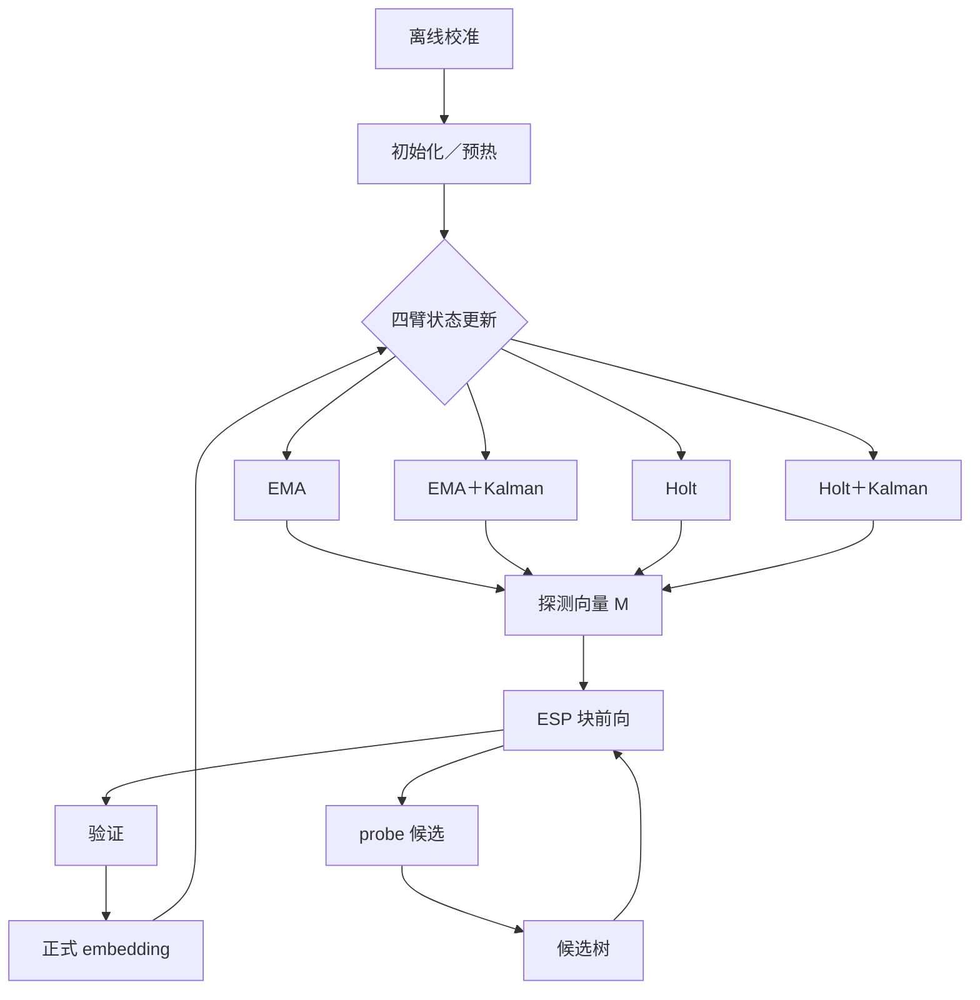

# Input探测状态与四组方案

2026年11月27日更新。当前讨论聚焦 input 探测槽的状态更新：保留原 ESP 的构树和验证，只比较 EMA／Holt 两种状态结构，以及固定／Kalman 两种增益机制。初始化、离线 calibration 和当前样本 warm-up 分别设计。本文说明当前选定的研究边界、算法关系和未决问题，不把历史试验当作新方案的结果。

## 一、当前方案与总体流程

| **主臂** | **内部状态** | **如何修正状态** | **探测槽实际读取** |
| --- | --- | --- | --- |
| EMA 固定增益 | M | 固定 α | 共享 M |
| 零阶 Kalman | M、P | 零阶协方差增益 G | 共享 M |
| Holt 固定增益 | M、V | 固定水平与趋势权重 | 共享 M |
| 水平—趋势 Kalman | M、V、P | 每维两分量的协方差增益 G | 共享 M |

四臂是“状态结构 × 增益机制”，不是四个互不相关的完整 decoder。M 是当前估计水平，V 是每 token 趋势，P 是估计误差协方差。固定臂不维护 P，Kalman 臂在线递推 P。当前所有附属槽使用共享 M，不额外按位置生成 M+hV。

### （一）离线与在线的两条链

图中上部是离线参数准备和当前样本的初始化，下部是原 ESP 中同时进行的 hard 候选验证与 soft 探测。正式提交之后按 token 顺序更新状态，探测得到的概率构造以后要验证的 hard 候选。

### （二）哪些环节保持不变

- 正常树节点使用具体 token ID 对应的 input embedding，附属槽才使用 soft M
- 候选来自 probe logits，沿用原有评分、扩展与剪枝规则，继续经过公共 verification
- block 预算、每节点附属槽数、树注意力、position ID、缓存保留、结束裁剪和目标解码规则在各实验臂之间固定
- M 的更新只影响以后实际执行的探测前向，不会改写已经算好的 logits、候选 token 或 hidden

本轮没有重新设计树、分支控制或验收准则，也没有把整个神经网络作为新的控制系统。verification 既确定正式 token，也确定实际前缀；当前状态更新先使用它提供的 input 标签，不加入额外 probe 观测融合。

## 二、从 hard 候选到 soft 探测

### （一）候选、位置与探测槽

P 表示前缀时容易与协方差重名，本文直接称“正式前缀”。根 r 是前缀之后已确定的一个 token ID，不是整个前缀，也不是 RoPE 编号。候选 A、B 是同一个位置的不同 token ID，可以共用 position ID，但 E(A)、E(B) 不同。RoPE 表达位置，树 attention mask 隔离分支，两者不产生 token 身份。

同一 soft 槽输出词表分布，保留多个 token 就产生分支。选中一个 ID 不代表已验证通过。树中 hard 节点在真实候选前缀条件下计算验证 logits，附属 soft 槽在对应假设路径下探测更远位置。每个 root／候选节点都可以配槽，不限于叶子，因为验收可能在中间节点停止。

输入位置 p 的输出预测 token p+1。当前槽位直接写 M，与后一个位置的 probe 输出不是同位置向量，不能随意作残差。具体树布局、RoPE 和并行验证见 [ESP 算法说明](<../算法说明 Algorithm Description/算法说明 Algorithm Description ESP.md>)。

### （二）BC30 的顺序

先给定总位置预算 B 和每个正常节点的槽数 k，再确定候选容量：

$$N_{\mathrm{budget}}=\left\lfloor\frac{B}{1+k}\right\rfloor-1.$$

例如 B=30、k=2 时有1个 root、9个候选、20个 soft 槽。历史缓存前缀不重复计入30。k=1 时容量为14个候选，不能把两种配置的结果当成同一棵树。

容量确定后，从较大的候选池中，按累计探测分数和原扩展约束保留预算内连通树。第一层7个、第二层2个只是论文例子，不是 BC30 固定层宽。探测评分也不是在所有 hard 前缀下已验证的真实路径概率，不保证全局最优子树。本轮只记录并固定这些配置，不优化每个节点的槽数。

## 三、为什么当前只保留 EMA 与 Holt

### （一）EMA 与 ESP 的对应

对正式 token embedding $z_t=E(y_t)$，EMA 更新为：

$$M_t=(1-\alpha)M_{t-1}+\alpha z_t.$$

ESP 的 mask 更新可重写成同一形式。当 prompt 均值初始化、更新 token、顺序／时点、权重和数值条件对齐，本轮将它作为同一零阶基线，不重复列实验臂。历史版本中不同精度或调度仍按来源记录，不把差异归因于新算法。[ESP §3.1](https://arxiv.org/html/2603.17942v2#S3.SS1)

“零阶”表示只跟踪水平，不表示没有历史记忆。展开 EMA 可见旧观测权重指数衰减，它也可解释为指数加权平方误差目标的水平估计。该统计解释不证明 embedding 的平滑状态假设成立。

### （二）Holt 的 V 怎样影响 M

先用旧状态预测当前位置，再用正式观测修正：

$$M_t^-=M_{t-1}+V_{t-1},\qquad r_t=z_t-M_t^-,$$

$$M_t=M_t^-+\alpha r_t,$$

$$V_t=\beta V_{t-1}+(1-\beta)(M_t-M_{t-1})=V_{t-1}+\alpha(1-\beta)r_t.$$

β 是旧趋势保留权重。新 M 估计当前位置，不是从当前 z 再向未来多走一步。V 先进入水平预测，再由同一观测残差得到修正。因此即使槽只读 M，Holt 的一阶状态仍会影响后续探测。

Holt 是指数平滑的局部水平—趋势结构，有创新状态空间解释，不是必然更优的公式。EMA 与 Holt 的统计来源及推导见 [EMA 算法说明](<../算法说明 Algorithm Description/算法说明 Algorithm Description EMA与Holt.md>) 和 [指数平滑作者教材](https://otexts.com/fpp3/exponential-smoothing.html)。

### （三）退出当前主比较的差分方案

原始差分 EMA 平滑 $z_t-z_{t-1}$。若 M 仍单独按零阶式更新，且槽只读 M，那么 V 没有进入实际探测输入。它不能仅凭“内部算了速度”成为有效的一阶比较。

让 V 进入 M+hV 或另选 z+hV 锚点，可以构成另一种方案，但改变了当前读出接口。这类外推不放进本轮四臂，也不在当前流程图里与 EMA、Holt 并列。较早关于差分和锚点的讨论保留在算法说明与沟通归档中。

## 四、Kalman 开关究竟改变什么

### （一）零阶从标量开始

先看一个 embedding 维度。x 是假设存在的平滑水平，M 是它的估计，z 是实际 token embedding。无偏条件下 P 衡量估计误差平方期望，Q 衡量一步状态变化，R 衡量观测相对潜在水平的偏差。教程用 Σ 表示估计协方差，本文的 P 与它对应。[教程 §6.1—6.2](https://arxiv.org/html/1710.04055v5#S6.SS1)

零阶的更新按顺序为：

$$M_t^-=M_{t-1},\quad P_t^-=P_{t-1}+Q,\quad G_t=\frac{P_t^-}{P_t^-+R},$$

$$M_t=M_t^-+G_t(z_t-M_t^-),\quad P_t=(1-G_t)P_t^-.$$

先因未知状态变化增加预测方差，再因观测融合降低方差。完整递推是 $P_t=R(P_{t-1}+Q)/(P_{t-1}+Q+R)$，并不是 P 只会无限加 Q。

### （二）Holt 式结构的每维2×2

每个维度有水平、趋势两个状态。P 保留水平误差、趋势误差及它们的协方差，Q 与两状态匹配，R 仍是该维水平观测的一个方差。4096维对应4096份2×2，不是默认一份共享矩阵，也不建立完整跨维8192×8192矩阵。

Kalman 根据协方差得到水平和趋势两个修正增益，槽仍只读更新后的 M。共享增益、冻结稳态增益是可选诊断，不是额外主方法。若所有维度参数和初始协方差都相同，仅复制矩阵不会自动产生不同增益。

### （三）当前冻结什么

Q、R 先离线拟合或按预登记规则选择，推理时冻结。零阶迭代 M、P，一阶迭代 M、V、P。固定 Q/R 时，当前残差直接修正 M/V，P/G 不直接因这一次残差变大就调大。用近期残差在线重估 Q/R 属于后续自适应机制。

verified token 的 input embedding 查表准确。R 描述的是它相对假设平滑水平的偏差，不是查表误差。我们尚未直接观测潜在水平，Q/R 的识别和轨迹假设需要检验。完整协方差方程与校准边界见 [卡尔曼算法说明](<../算法说明 Algorithm Description/算法说明 Algorithm Description Kalman.md>)。

## 五、初始化、calibration 和 warm-up

| **概念** | **数据范围** | **决定什么** |
| --- | --- | --- |
| 初始化 | 每条样本开始时 | 设置 M0，必要时 V0、P0；可以由规则产生，不必全样本共用同一向量 |
| Calibration | 跨样本、多个数据集和较大样本 | 离线估计固定权重、Q/R、初始化规则或参数，并在评测前冻结 |
| Warm-up | 当前样本推理前已可取得的 prompt、prefill／preview | 按已有规则预热当前状态，得到开始生成时的 M/V/P |

这不是三个互斥方案。可以离线校准参数，再对每个 prompt 做 warm-up。ESP prompt 均值是一个可保留的初值策略，不是唯一标准。Holt 可从 V0=0 开始，也可由 prompt 估计趋势，需单独比较。P0 表示初始估计有多不确定，不等于 prompt token 的样本协方差。

当前先固定一种初始化比较四臂，再固定算法比较初始化。calibration 尽量扩大覆盖和样本量，但不能以“更多”为由混入最终 eval。preview 若增加模型调用或引入额外信息，须记录来源和成本。

## 六、已有证据、当前问题和下一步

4B E1 的零阶、差分、Holt、动态 Kalman、冻结增益 τ 分别为1.4413、1.4486、1.4444、1.4240、1.4476。8B input 四臂对应零阶、差分、Holt、Kalman 为1.5030、1.5019、1.4963、1.4710。历史实验没有建立动态 Kalman 优势，且存在显式外推、共享协方差等协议差异，不是本轮 M-only 四臂的已验证结果。

现在要回答的是：固定原 ESP 接口后，Holt 的内部趋势能否改善 M？Kalman 增益能否超过同结构的固定权重？初始化、calibration 和 warm-up 对结论各有什么影响？更大、多来源校准得到的参数能否冻结迁移？

具体执行由代码仓库唯一 [研究计划](<../研究计划 Research Plan 去噪推测解码.md>) 承接。先做公式和时序合同，再做固定初始化的四臂开发比较，接着隔离初始化与校准规模，最后冻结参数确认迁移。主要指标为 A/C 与 τ=S/C，几何误差、似然或覆盖率仅辅助，耗时不用于方法排名。

## 七、暂缓项与资料入口

output、差分显式外推、额外 probe 多观测融合、Jason 组合、在线 Q/R、可变每节点探测槽和新验收准则都不属于当前主比较。原讨论的完整修改链由本地沟通归档保留，本文不再附旧分类和旧总图。

- [研究计划](<../研究计划 Research Plan 去噪推测解码.md>)：假设、实验分期、校准与独立评测
- [ESP 算法说明](<../算法说明 Algorithm Description/算法说明 Algorithm Description ESP.md>)：正常节点、附属槽、BC、attention／RoPE 和验收
- [EMA 算法说明](<../算法说明 Algorithm Description/算法说明 Algorithm Description EMA与Holt.md>)：EMA／Holt 递推、差分关系及历史实现
- [卡尔曼算法说明](<../算法说明 Algorithm Description/算法说明 Algorithm Description Kalman.md>)：标量与逐维两状态滤波、校准和初始化
- [学习笔记](https://dreamsoul.feishu.cn/docx/Y7nEdzJZ2oe32Kx2YpQcqrPFnJf)：按数学对象逐步学习的过程
- [指数平滑文献调研](https://dreamsoul.feishu.cn/docx/CvJ4dDoIgoaCKpxOdQ5cWBc3n4b)：已有方法、阅读范围和来源

当前只完成研究定义和文档统一，尚未执行 M-only 新四臂或大样本 calibration，不宣称已验证收益或新颖性。

飞书学习笔记和外部协作文档需要对应访问权限，仓内算法与计划可独立阅读。
