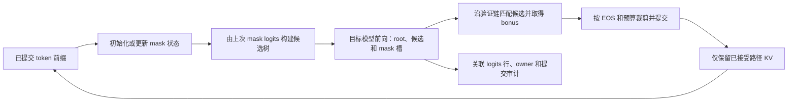

**去噪推测解码 通用调研**
更新日期：2026年11月5日。研究范围是免训练多 token 预测、ESP、输入/输出掩码和接受验证，以及支撑证据保全的运行机制。本文维护机制、方案、直接来源和当前判断。历史数字在 [运行记录](<运行记录 Run Record/2026-10-31 历史证据归位.md>)，职责在 [架构设计](<架构设计 Architecture Design 去噪推测解码.md>)，待检验问题在 [研究计划](<研究计划 Research Plan 去噪推测解码.md>)。学术阅读深度在 [文献调研](<文献调研 Literature Review 去噪推测解码.md>)。

# 一、核心问题与结论
本项目要回答：没有辅助训练或额外起草模型时，怎样从同一目标模型获得多个候选，哪些掩码与树结构能提高接受效率，以及什么证据足以支持正确性和收益判断。

现有结果支持在固定条件下比较接受数与调用数。8B 非官方独立复验三格数学自检通过，但 BC30/60 未复现论文目标。4B 五方法中输入一阶总量最好，输出一阶没有稳定联合优势。同范数随机偏置也能改善零偏置基线，尚不能把范数认定为唯一机制。历史结果不是新的执行指令。

# 二、方法地图与已有实现
## （一）起草方式是主要分类轴
自回归逐 token 生成先得到一个可靠参照。推测解码再把“提出多个候选”和“按目标模型确认候选”分开，让一次目标前向覆盖更多可能续写。Leviathan 等的原论文研究辅助模型与保持目标分布的采样方法，Chen 等采用修正拒绝采样，二者的分布论证都有算法与数值前提。本文对两篇的阅读范围为摘要，理论推导未复核。[Leviathan v2](https://arxiv.org/abs/2211.17192v2)、[Chen v1](https://arxiv.org/abs/2302.01318v1)

| **路线** | **候选来自哪里** | **主要成本与限制** | **本项目位置与直接来源** |
| --- | --- | --- | --- |
| 小模型起草 | 独立较快模型提出短续写，目标模型验证 | 额外模型、内存、对齐与采样合同 | 概念对照，未实现。Leviathan/Chen |
| 多预测头 | 同一主干增加多个未来 token head，再作树验证 | 需要头训练，部分方案同时微调主干 | Medusa-1/2 的训练范围不同，本仓未集成。[论文 v3](https://arxiv.org/abs/2401.10774v3) |
| 特征外推 | 在目标模型特征上预测后续表示，再构造候选 | 需要专门模型/训练和精确特征合同 | EAGLE 官方仓提供相关实现，不能等同本仓 EMA。[官方 README](https://github.com/SafeAILab/EAGLE#readme) |
| 历史 token 检索 | 从已有输入/上下文匹配 n-gram 后续 token | 受重复度和任务影响，仍须验证 | PLD 是免训练、无独立神经起草器的比较路线，本仓未实现。[原作者项目](https://github.com/apoorvumang/prompt-lookup-decoding#readme) |
| 同模型 embedding 探测 | 给冻结模型注入合成 embedding，读取未来候选并验证 | 树/槽增加前向工作量，候选质量受表示与结构影响 | ESP 是最接近基线，本仓是非作者官方实现。[ESP v2 §3](https://arxiv.org/html/2603.17942v2#S3) |
| 输入/输出 EMA 掩码 | 用已提交 embedding 或隐藏状态构造零/一阶预测 | 状态更新、范数、代理与映射引入不同假设 | 本仓研究方法，性能与新颖性限于现有证据，见第三章 |

树形与链形是候选组织轴，T0/采样是验证轴，静态/动态是预算分配轴，三者分别影响接受与执行开销。免训练只说明不新增训练，不能由此推断无额外算力、无需验证或适用于所有模型。
## （二）ESP 与本地技术路径
ESP 用 prompt embedding 均值初始化 mask，生成时按新 token 以 λ 更新；同向量在不同位置及上下文产生不同预测。候选按累计概率构成树，剪枝替换父子连续重复 token。论文提供静态 attention/position 优化，正文与 Table 1 的输出长度/硬件描述需按实验分别对齐，不能拼成统一合同。[ESP v2 §3、Table 1](https://arxiv.org/html/2603.17942v2#S3)

下面解释本仓当前实现，不作为作者源码的转述。mask 是直接拼入 `inputs_embeds` 的连续向量，没有先反查词表 ID。前向输出 logits 才产生候选 token。一次块包含 root、候选树及每个节点的 mask 槽，大小为 `(k+1)×(1+ΣK_i)`。本地单槽 BC30 对应14草稿节点，双槽 BC30 对应9节点，BC 相同不代表树相同。[当前解码器](../src/spec_mtp/structure/algorithm/decode/loop.py)、[树构建](../src/spec_mtp/structure/algorithm/decode/tree.py)

图为本地机制分析，箭头是数据和处理顺序，所有框首先在同一解码进程。prefill 先计算首 token 与首棵树的 seed；后续每步验证接受路径并产生下一棵树 seed。被拒 draft 不能进入长期 mask 历史，bonus 在下一步作为 root，步后 `cache_len == root_pos`。验证、缓存剪裁和下一步 seed 归属必须一起核对。[当前解码器](../src/spec_mtp/structure/algorithm/decode/loop.py)、[KV 操作](../src/spec_mtp/structure/model/hf_causal.py)

# 三、掩码状态、观测与验证语义
## （一）输入 embedding 的零阶与一阶
当前 ESP provider 的均值更新为 `m ← (1−λ)m + λe_new`，对每个已提交 token 依次执行。`update:false` 冻结 prompt 均值，last-k、sample embedding 和偏置初始化是不同消融。采样初始化用生成器 fork，避免初始化噪声消耗正式采样流。[providers.py](../src/spec_mtp/structure/algorithm/mask/providers.py)

当前输入速度为 `v ← βv + (1−β)(e_new−e_prev)`，mask 槽为 `origin + γi·step(v)`。prompt 第一差分播种后依序更新，没有 Adam 式偏差校正。`origin` 可为末 token 或按 λ 更新的均值；β=.9999 的记忆保留特性取决于播种与后续长度，不能只用 β 数字说明效果。`normalize` 使用差分范数 EMA 定尺度，`extrapolate_ema` 仅模拟块内状态，不污染 committed 状态。速度关闭仍可更新 last anchor 与零阶均值。这里 γ 是步长尺度，不叫 slope。[providers.py](../src/spec_mtp/structure/algorithm/mask/providers.py)
## （二）输出隐藏状态的预测与映射
当前 `OutputHiddenMaskProvider` 观察 final normalized hidden，内部 anchor/velocity 以 FP32 保存，模型前向与最终 mask 可为 BF16。已提交真实隐藏状态更新长期 anchor，速度衰减 β；块内 proxy 以 β′ 模拟 owner 状态，生成不同深度的预测。临时 proxy 不能写回长期 committed 状态。[providers.py](../src/spec_mtp/structure/algorithm/mask/providers.py)

其映射为 `Φ(z)=s·z/||z||`，`s` 为输入 embedding 表平均行范数，拒绝非有限或零范数。tied embedding 与输出 head 的实际共享存储是现有输出路径前提，不能只看模型配置的布尔标记，也不能把归一化映射叫逆模型。序列/owner 对齐错一位，就可能用错 proxy 预测下一树，即使类型形状相同。[providers.py](../src/spec_mtp/structure/algorithm/mask/providers.py)、[模型接入](../src/spec_mtp/structure/model/hf_causal.py)

EMA 可平滑历史变化，但这本身不提供噪声观测模型、协方差、Kalman 增益或最优估计证明。“去噪推测解码”是项目名称。本仓没有 diffusion 去噪模型。输出隐藏上的对角混合卡尔曼 `output-hidden-hybrid-kalman-v1` 已作为负结果消融关闭：它没有同时超过 ESP 和 output hidden 原版，0.6B 的接受数下降来自 output hidden 轨迹本身。嵌入空间里、节点数与 ESP 相同的替换比较随后也没有在 SpecBench 新切片和 Dolly 上让 4B 与 0.6B 一起通过。输出一阶仍要由配对结果检验，不能由公式名称认定成立。

2026年10月20日确认的记号是 `K=[A,b]`，形式为 `z′=z+A[e(y)−e(m)]+b`。协议 `postcommit-final-norm-v1` 仍是已提交位置上的离线三臂。输出隐藏上的对角混合卡尔曼是另一次测量，结论见上一段。对照和停止条件在研究计划。
## （三）四种正确性与效果问题
| **问题** | **需要的证据** | **现有范围** |
| --- | --- | --- |
| 提交是否服从这次验证 | 提交 token、forward/row/owner、argmax、输入/输出哈希与完整覆盖 | T0 正确性门已实现，历史数字在运行记录，当前未重跑 |
| 是否等于独立 AR | 同模型/输入/预算的完整独立序列、首分叉与长度 | BF16 历史有大量差异，只诊断；不以自检覆盖它 |
| 随机采样是否保持目标分布 | 明确算法前提、随机数合同、分布推导与适当验证 | 本仓未完成一般保证；共享 generator 的路径观察不足以单独证明 |
| 是否实际更快/更省 | 同质量与输出协议、硬件/预热/同步、完整端到端时长/资源 | 此阶段不测速，零计时占位不作测量 |

验证前向形状与逐 token AR 的浮点路径可能不同，是现有差异的候选解释，不是本轮完成的因果归因。缺原始 logits/审计时，摘要 JSON 与模型名都不能补证原始 argmax。保留负结果比事后更换成功门更能限定结论。

# 四、实现来源、取舍与当前证据链
## （一）三类实现严格分开
本仓的 `spec_mtp` 是非作者官方研究实现；第三方 HF 代码固定为 `ad76f8da29f3bfc7faa20488193c6aa83a9f708c`，原 README、四份 code 和三份 results 全部保留，来源清单为 [ORIGIN.json](../src/spec_mtp/structure/algorithm/reference/esp_reproduction_artifacts/ORIGIN.json)。该固定来源未附 LICENSE，许可状态保留未确认，不据此扩大使用许可。[HF 固定来源](https://huggingface.co/datasets/Harshvardhan-Mestha/esp-reproduction-artifacts/tree/ad76f8da29f3bfc7faa20488193c6aa83a9f708c)

来源分类以实际取得的原件为准，不能由未取得可运行原码断言作者从未开源。论文主张、第三方复现和本仓测量分别定位到文献与运行记录。
## （二）当前源码职责与目标差距
Study recipe 注册宿主的 Data、Model 和 Algorithm，默认 prepare/execute 复用阶段实现，专项 collect/summarize/write/process 计算和核验证据。专项 `sources.py` 记录被复用宿主与共享适配的源码锁。模型输入、权重 digest、tokenizer/runtime 和原始输出在最终验收前复核。[来源锁](../studies/_shared/structure/sources.py)、[证据](../studies/_shared/structure/evidence.py)、[验收门](../studies/_shared/flow/summarize/run.py)

科学合同、数据、模型、计算与产物按 structure 职责分开，flow 装配并协调执行。RPipe 作为结构参考，流程由本仓实现。实现差距见开发计划。

## （三）设计输入
| **约束** | **为什么保留** | **最小设计响应** |
| --- | --- | --- |
| 科学行为与生命周期分离 | 来源拒绝、复算和取消不应改变 token/状态公式 | 科学包提供生成/审计/分析合同，Study 薄适配执行 |
| committed 与 proxy 状态分开 | 拒绝候选或模拟状态不能泄漏下一轮真实历史 | 解码会话独占 KV、mask、RNG，审计 owner 与行 |
| 原始证据和摘要分开 | 聚合数字不能证明原始前向正确 | 运行根保留 raw，正文只维护必要摘要与原件定位 |
| 质量与进度分开 | execute 完成、来源完整、数学自检、论文目标分别可能失败 | 多维结果不压成一个 success/complete |
| 先满足当前研究规模 | 尚无远程伸缩或多后端平台需求 | 单机模块和一个执行协调者，不建服务与通用插件市场 |

# 五、来源、阅读范围与未验证事项
下表维护来源版本和实际阅读范围，原文、源码及历史测量分别解释；逐次访问与执行事实从日期记录追溯。

| **来源** | **版本与阅读范围** | **用途与限制** |
| --- | --- | --- |
| [ESP 原文](https://arxiv.org/html/2603.17942v2) | v2，2026年5月28日，针对性读 §2/3、Algorithm 1、Table 1 与 G.2 定位，未全文重证附录 | 最近方法与论文合同，不能据作者性能数直接认定本仓速度 |
| [Leviathan 原论文](https://arxiv.org/abs/2211.17192v2) | v2，2023年5月18日，摘要与版本核对 | 辅助起草和分布目标，未重新证明采样论证 |
| [Chen 原论文](https://arxiv.org/abs/2302.01318v1) | v1，2023年2月2日，摘要 | 拒绝采样路线，与本仓 T0 门有范围差异 |
| [Medusa 原论文](https://arxiv.org/abs/2401.10774v3) | v3，2024年6月14日，摘要和两种训练范围 | 比较多头路线，未读/运行完整实现 |
| [EAGLE 官方](https://github.com/SafeAILab/EAGLE#readme) | 滚动 README，针对性读特征外推与官方实现身份，未固定源码 commit | 说明公开实现路线，不声称基准条件相同 |
| [PLD 原作者项目](https://github.com/apoorvumang/prompt-lookup-decoding#readme) | 滚动 README，概念与示例入口，未运行 notebook | 说明无额外模型的检索起草，不承诺宿主兼容版本 |
| [Spec-Bench 官方](https://github.com/hemingkx/Spec-Bench#readme) | 滚动 README、数据目录和项目许可入口 | Benchmark 责任与数据来源，本地历史数据 commit 未确认，原数据字节另有 SHA；组成数据许可未逐项核查 |
| 本仓源码及 H01–H09 | 固定基线 `b8b20b5`，读取入口、mask、decoder、来源/验收和相关历史报告 | 源码分析/历史测量，不是本轮模型或全仓审计 |
| DreamSoul 架构方法四资料 | 本地2026年10月21日版：主报告、大纲、端侧案例、来源索引全文 | 采用质量场景、黑盒合同、源码/运行视图、状态唯一归属、取消与简约取舍；未重读全部原标准 |
| [RPipe固定main](https://github.com/DreamSoul-AI/RPipe/tree/414ccb7be5d4eb3739ccc09a4774cad7e8e1a9e6) | AGENTS、README、train.py、resume.py、artifact/checkpoint.py全文 | 读取、准入、应用与快照提交机制；没有运行其测试或复制编码/API |

资料读取与环境访问的逐次事实从 [开发记录](<开发记录 Development Record/2026-11-05 宿主结构收束.md>) 追溯，不以历史认证状态推定当前资料是否可读。论文阅读范围仍从文献调研定位。

后续研究范围由当前研究计划维护。既有 trajectory/observation 公式与测量按固定历史协议解释，已观察数据不能充当新算法的独立确认集。采样分布保证仍未完成。工程目录调整保持依赖版本和历史科学语义。

# 六、训练快照的提交边界
远端RPipe main固定为 `414ccb7be5d4eb3739ccc09a4774cad7e8e1a9e6`。实际阅读其AGENTS、README、train/resume与checkpoint源码：structure描述科学部件和持久化，flow拥有生命周期；训练状态读取、准入和应用分开，快照以文件原子替换为可见提交边界。其实现先将payload写入同目录独占临时文件，flush/fsync后替换目标；提交前失败保留旧文件，并保留首错及清理错误。[固定训练实现](https://github.com/DreamSoul-AI/RPipe/blob/414ccb7be5d4eb3739ccc09a4774cad7e8e1a9e6/src/rpipe/structure/algorithm/train.py)、[固定快照实现](https://github.com/DreamSoul-AI/RPipe/blob/414ccb7be5d4eb3739ccc09a4774cad7e8e1a9e6/src/rpipe/structure/artifact/checkpoint.py)

RPipe当前编码为带schema/kind/payload的snapshot并使用weights_only读取，允许值域受显式校验约束。本仓既有bundle含NumPy RNG和诊断分片，不能直接换编码并声称旧格式兼容。采用同目录临时文件、完整文件同步及最后替换的机制，保留当前数据合同；分片仅供诊断，不能因文件存在就补签完整bundle。提交后诊断清理失败与提交前写入失败须分开处理。文件同步与原子替换不能单独证明硬件掉电场景的全部持久性，也不提供同Run/stem并发写入保证。[当前System](../src/spec_mtp/structure/system/factory.py)、[恢复准入](../src/spec_mtp/structure/algorithm/resume.py)
