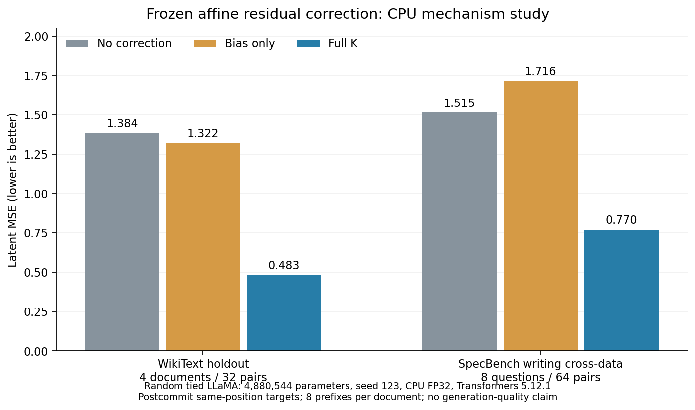

# K affine residual correction — CPU mechanism study

Completed native v2 Run `171d55477ad7c899` validates the registered numerical pipeline. Frozen full K reduced heldout/cross-dataset latent MSE against both controls on this random model. It does not establish language-model quality, future-slot hit rate, model dependence or general data independence. The [lossless evidence](evidence/cpu_v2.json) contains all actual latent arrays and frozen controls; [NUMBERS](NUMBERS.md) is the native one-Run aggregate.

## Registration history

Pre-execution implementation status. The [registered project plan](<../../../docs/研究计划 Denoising Speculative Decoding.md#k-affine-residual-20261020>) / [English](<../../../docs/Research Plan Denoising Speculative Decoding.md#k-affine-residual-20261020>) is committed at `ac1162448d7b129e5d8b50d97dc1bd46e6cfee96`. Registration and data selection preceded model construction/output inspection. The first registration check found the first SpecBench question had22tokens; before outputs, all splits' eight positions were fixed to4/6/8/10/12/14/16/20. This is an input-feasibility correction, not a negative model result.

Implementation and focused tests are new Study-local research. No shared algorithm or old Study changed. Unit arrays test formula/validation only; they are not observed model improvement. Old technical debt repayment:0.

## Pre-model v1 execution failure and v2 registration

Native make succeeded at source commit `213abb78af32954a23c72d61b15e8bb0bd300b18`. Run `eb1b335165f9edf3` failed in prepare because registration stored the CRLF working-plan SHA while the immutable Git blob uses LF. The same native launch's default retry failed at the same gate. No data/model construction, hidden extraction or K fit occurred; `assets/affine` does not exist. Local raw receipt `.tmp/debt-batch12/native-001/receipt.json` records outer9.0274s, unchanged selected inputs, owned0 and closed Job. The earlier standalone preflight also detected this mismatch, but its caller failed to stop before invoking the guard; this operational error is retained. All28 Study files were copied with hashes to `.tmp/debt-batch12/native-001-closed-snapshot/`, preserving original Run/config/result/logs and index/scripts/provenance before v2 make. These local paths are not distributed by clone.

V2 changes only execution version and precise plan identity: keep the original working SHA and independently register the actual `ac116` Git blob ID/raw SHA. Both must match, with no newline normalization or relaxed content gate. The one-time native worker now checks preflight via raising subprocess calls and assertions before make. New tests accept independently registered LF/CRLF bytes and reject drift on either side. Data selection, positions, random-model seed, ridge, independent bias baseline and all scientific comparisons remain frozen. This newly introduced Study integration correction is not counted as repayment of an old debt.

## Completed v2 and actual model

Run source commit `b72634b8e391a9df9d5a1f9448f01b471b5dfd22` was clean before execution. Native make, launch, process, status and generic RPipe report all exited0; Run status is `succeeded` and Study `process.complete=true`. This successful launch contains one execute and no retry. SpecMTP's report command adds an old decoding-specific gate, so this independent latent Study uses the same framework's generic `rpipe report`, without changing shared code or pretending to be an ESP decoding Run.

Actual model: randomly initialized official LLaMA, 4,880,544 unique parameters; state_dict entry element sum9,742,496 counts tied embedding/head twice and is not physical storage. The runtime checked tied pointers=true, hidden32, intermediate64,2layers,4heads/2KVheads,vocab151936,positions128,CPU/float32/eager,seed123,1Torch thread,Transformers5.12.1/Torch2.11.0+cu130. The CUDA build string is not GPU execution. Qwen3-0.6B provides only its cached tokenizer; its model weights were not read or loaded. Model state digest was identical before/after; model weights were not trained.

All20 documents and160 latent pairs were retained: WikiText8fit/4holdout documents and8SpecBench writing questions(qid81–88),8positions each. Full-document and exact cross-split-prefix intersections are zero. For already committed teacher-forced P,y, both soft-mean z(m) and target z(y) are observed at the same last position; no future label enters the pair. K/bias were fitted once from64fit rows and saved before any holdout/cross hidden extraction. Frozen NPZ SHA256 is `940b6f7176b1a551c4bf3f793422e650f6a379cc6f05cd199c2b3ea823791057` and stayed unchanged. Bias-only is the independently fitted fit-residual mean, not the full-K intercept.

Actual precision matters: embeddings/x/hidden observations are FP32; residual is computed by FP32 `ztrue-zmask` **before** conversion to float64. Centered ridge(lambda.001), intercept, calibration application and latent MSE/cosine use float64. For diagnostics, corrected hidden is cast to FP32, the LM-head runs FP32, then logits are converted to float64 for log-softmax/KL. These mixed-precision steps are preserved, not replaced with an algebraically similar FP64-residual oracle.

## Observed comparisons

MSE averages32coordinates, then8positions per document, then documents equally. All arms share the same observed pairs. Fit is resubstitution; it is not heldout evidence.

| **Partition** | **Documents / pairs** | **None MSE** | **Independent bias MSE** | **Frozen full K MSE** | **Full wins vs none / bias (documents)** |
| --- | ---: | ---: | ---: | ---: | ---: |
| Fit | 8 /64 | 1.480373731 | 1.365735373 | 0.133362407 | 8/8 /8/8 |
| Same-dataset holdout | 4 /32 | 1.384082070 | 1.322365278 | 0.482591407 | 4/4 /4/4 |
| Cross-dataset | 8 /64 | 1.514774825 | 1.715879881 | 0.769911498 | 8/8 /8/8 |

Full K lowers MSE versus none by about65.1% on the four heldout documents and49.2% on the eight cross-data questions. The separately fitted bias worsens cross-data MSE versus none, preserving a useful negative control. Full-K target-hidden LM-head argmax agreement is12/32=.375 on holdout and13/64=.203125 across data; none/bias are0 on both. These compare distributions induced by actual z(y), not ground-truth next-token correctness or speculative acceptance. Full-K KL(target||arm) is.003091334/.004925549 respectively. Full per-document paired differences, cosine and all per-row diagnostic scalars are retained in evidence; n=1 Run/seed and n=4/8 documents do not establish population significance or robustness.

Figure: the same retained Run and document-weight MSE table above. Random tied LLaMA, 4,880,544 unique parameters, seed123, CPU FP32, Transformers5.12.1. No uncertainty bars or model-quality claim. Image metadata binds the exact cpu_v2.json SHA.

## Verification and persistent evidence

Final focused suite:17passed/4.45s; Ruff and Python3.10 AST checks passed. It checks ridge against independent augmented normal equations, separately fitted bias, constants/zero residual, invalid fit inputs, document/prefix leakage, evaluation immutability, real tiny-model causal/same-position observations, complete negative-result acceptance, raw drift rejection, native phase export and LF-blob/CRLF-worktree identities. It is additional engineering verification; the actual Study Run supplies the reported160 model pairs. Earlier10P/14P are intermediate snapshots, not final counts. A13P/1F test-construction round overconstrained the error message for corrupt JSON; rejection already worked and the assertion was corrected. All original rounds remain local.

The stdlib-only post-run reader decoded all actual NPY arrays, rehashed181selected source/test/plan/controller inputs and13read-only input assets, independently recomputed bias from FP32 residuals, all frozen predictions, MSE/cosine and scalar aggregations. Maximum prediction difference was1.33e-15 and aggregate difference2.22e-16; no tolerance was loosened. Root separately verifies the full ridge via augmented equations with the actual residual precision. These checks do not re-execute the model, refit using evaluation data or modify K.

[cpu_v2.json](evidence/cpu_v2.json) losslessly includes12original files totaling339,357bytes as zlib/base64: full x/zmask/ztrue/three-arm predictions and scalar diagnostic arrays, frozen K/independent bias, row maps, freeze/model/execution/analysis/binding, config, result,index andprocess. Each raw byte length/SHA is indexed; clone readers can reconstruct all latent/calibration evidence. It does not contain model weights or all-vocab logits. Full-vocab head diagnostics were actually computed, but only per-row reductions were persisted; this archive does not independently reconstruct those missing logits. Local full logs/guard/resources and181-input maps remain under `.tmp/debt-batch12/native-002/` and `native-002-stdlib-check.json`, not as distributed links.

## Actual cost and stop

| **Attempt** | **Outcome** | **Outer wall seconds** |
| --- | --- | ---: |
| unit-001 | intermediate10P | 6.5955 |
| unit-002 | test error-message assertion1F/13P | 6.5854 |
| unit-003 | intermediate14P | 6.5428 |
| unit-004 | final17P | 6.6127 |
| native-001 | v1 two prepare failures,0model/0fit | 9.0274 |
| native-002 | v2 complete native chain | 15.7228 |
| All unit/native attempts | bounded executions, all owned0 | **51.0867** |

Successful execute itself took1.0832s; this is operational accounting, not a model benchmark. Input-registration/token-length probes add about17.74s of known preparatory command wall time. Manual editing, other stdlib preparation and review time were not uniformly timed and remain unknown;51.09s is not total project elapsed time. The registered600s unit/native CPU-execution budget was not exhausted. Final sampled tree RSS peak was1,361,358,848bytes; Job committed-memory accounting is separately retained. RSS sampling was observational, not an enforced2GiB limit. The180s outer deadline and160s native command-chain budget were enforced. Every attempt preserved selected input bytes and finished owned0/Jobclosed, with no Job cleanup errors. No download,GPU,paid resource,large training or old queue was started.

## Judgment and untested boundaries

This small phase supports a limited positive observation: one frozen affine calibration transfers to the predeclared holdout and cross-data inputs of the same random model better than both controls. Its target is postcommit replacement of an already known token. It is not a future-slot forecast or a generated-token hit-rate experiment. Short WikiText prefixes include headings and the cross set covers only8writing questions; the random shallow model uses a tokenizer whose linguistic semantics it has never learned. An embedding-dominated random residual is a plausible alternative explanation, not a verified mechanism in pretrained models.

K is fitted from data, so cross-data improvement here cannot prove general data independence. No second model was tested, hence model dependence also remains unverified. No quality/perplexity/acceptance/tau/latency/throughput claim follows, nor equivalence to Kalman filtering, diffusion spectra or flow matching. This one registered CPU stage is complete and stopped; a pretrained/multiple-model/future-slot extension needs its own scoped plan and budget. Failed v1 results are not re-signed. Old debt repayment remains0.

## Publication archive correction (2026-10-20)

The first CI on head `376e5fc339a9589898f4438591ec40c0000686d6` finished1failed/834passed in539.53s. Its only failure, `test_relative_markdown_links_resolve`, found that the tracked native NUMBERS report linked to an untracked local Run log, absent in a clean clone. [The original CI](https://github.com/DreamSoul-AI/denoising-speculative-decoding/actions/runs/39432157073) remains failed and retained; lint,mypy,pin and Branch flow passed. The publication copy now labels that path inline as local-only; the generic local-Run report generator is unchanged. No metric/table value, frozen K, scientific source or Run `171d55477ad7c899` changed, and this documentation publication correction counts as0old source-debt repayments. The original doc gate is checked against fresh Git-archive exports without ignored Run directories, not against a local workspace containing the log.
